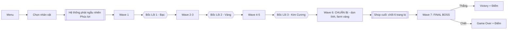
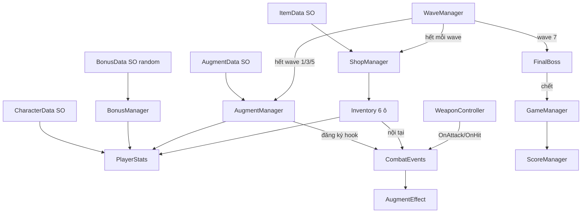

# ⚔️ ARAM MAYHEM CAMPAIGN — KẾ HOẠCH TRIỂN KHAI
> **Dự án:** ARAM Mayhem Campaign  
> **Thể loại:** 2D Top-Down Arena Roguelite (Bullet Heaven / Auto-Shooter)  
> **Nền tảng:** Unity 2D (C#) | **Cảm hứng:** Brotato × ARAM: Mayhem (LoL) × Gà Máy (TFT)  
> **Slogan:** *Roll Augments. Build Stats. Beat the Boss.*

---

## 📑 MỤC LỤC
1. [Tổng quan & Phạm vi (Scope)](#1-tổng-quan--phạm-vi-scope)
2. [Game Design](#2-game-design)
3. [Kiến trúc Code](#3-kiến-trúc-code)
4. [Roadmap theo Milestone](#4-roadmap-theo-milestone)
5. [Asset miễn phí](#5-asset-miễn-phí)
6. [Đề cương báo cáo 3 chương](#6-đề-cương-báo-cáo-3-chương)
7. [Rủi ro & Cắt giảm](#7-rủi-ro--cắt-giảm)

---

## 1. TỔNG QUAN & PHẠM VI (SCOPE)

### 1.1. Đã có (Base Player - Part 1 từ tutorial)
- `Player` (Rigidbody2D gravity 0, CircleCollider2D, Animator, `Player.cs`): di chuyển WASD, lật sprite, `Hit(int)`, `Die()`, hiển thị HP (TMP).
- Animator: `PlayerIdle`, `PlayerRunning` (float `velocity`), `PlayerHit` (trigger `hit`). Child `Sprites` có `hitSprite` nháy trắng.

### 1.2. Phạm vi đã đơn giản hóa (MVP)
| Hạng mục | Quyết định |
| :--- | :--- |
| Thể loại | Top-down arena kiểu Brotato, **không** có bụi cỏ/cục máu/map phức tạp |
| Nhân vật | **4 class**: Xạ Thủ (AD), Pháp Sư (AP), Đỡ Đòn (Tank), Đấu Sĩ (Bruiser) — **làm AD trước**, các class khác sau |
| Vũ khí | **1 vũ khí/nhân vật**, tự ngắm mục tiêu gần nhất |
| Trang bị | **Tối đa 6 ô**, **chỉ có được bằng cách mua ở Shop** (giai đoạn đầu) |
| Lõi nâng cấp | Bốc **tối đa 3 lần** (Bạc → Vàng → Kim Cương), mỗi lần 3 thẻ |
| Phúc lợi đầu game | **Hệ thống phát ngẫu nhiên 1 phúc lợi** — người chơi phát triển lối chơi theo phúc lợi nhận được |
| Mục tiêu | **Không vô tận**: 5 wave thường → **Wave 6 Chuẩn Bị** (dọn lính, xếp đồ) → **Wave 7 Final Boss** → màn hình điểm |
| Skill chủ động | 1 kỹ năng riêng mỗi class (phím Space), có hồi chiêu |

---

## 2. GAME DESIGN

### 2.1. Game Loop (1 ván ≈ 7–9 phút)

- Wave 1–5: mỗi wave 45s; quái tăng dần số lượng/máu, rơi **Vàng**.
- **Sau mỗi wave → mở Shop** (mua trang bị, reroll shop). Ở các mốc wave 1/3/5 thì bốc Lõi trước rồi mới vào Shop.
- **Wave 6 – Chuẩn Bị (Prep Wave):** 30–40s, quái yếu nhưng đông, rơi nhiều vàng (x2). Mục tiêu là **dọn lính & gom tiền để xếp đồ hoàn chỉnh** trước Boss. Sau wave 6 là **Shop cuối** (giảm giá reroll).
- **Wave 7 – Final Boss.**
- Điểm = (Quái giết × 10) + (Thời gian còn sống) + (Bonus máu còn lại) + (Bonus giết Boss nhanh) + (Vàng còn dư × 1).

### 2.2. Nhân vật (4 lối chơi)
| Class | Scale theo | Vũ khí | Skill (Space) |
| :--- | :--- | :--- | :--- |
| Xạ Thủ (AD) | AD, tốc đánh, crit | Súng (đạn thẳng) | Dash + +50% tốc đánh 3s |
| Pháp Sư (AP) | AP, haste, AoE | Gậy phép (cầu lửa nổ) | Bão lửa quanh người |
| Đỡ Đòn (Tank) | Máu, giáp, hồi máu | Rìu (chém quét, đẩy lùi) | Khiên phản 50% sát thương |
| Đấu Sĩ (Bruiser) | Máu + AD + hút máu | Kiếm (chém rộng) | Hú: +tốc chạy, +hút máu |

Mỗi nhân vật có **buff/debuff nền** (vd: Tank +30% HP, −20% tốc chạy) hiển thị ở màn chọn.

> **Ưu tiên phát triển:** Xạ Thủ (AD) là class làm đầu tiên và dùng để test toàn bộ hệ thống (vũ khí, lõi, shop, boss). 3 class còn lại chỉ là thêm `CharacterData` + vũ khí + skill sau khi AD chạy ổn.

### 2.3. Phúc lợi đầu game (Hệ thống phát ngẫu nhiên)
Sau khi chọn nhân vật, hệ thống **random 1 phúc lợi** (hiệu ứng lật thẻ). Người chơi **không được chọn** → buộc phải thích nghi và phát triển lối chơi theo phúc lợi, tạo sự khác biệt giữa mỗi ván.

| # | Phúc lợi | Hiệu ứng | Gợi ý lối chơi |
| :-: | :--- | :--- | :--- |
| 1 | **Vé May Mắn** | +2 lượt Reroll lõi miễn phí | Săn lõi Kim Cương mạnh |
| 2 | **Túi Tiền** | +100 Vàng đầu game | Lên đồ sớm, mạnh đầu trận |
| 3 | **Lõi Tiên Phong** | Bốc thêm 1 lõi Bạc ngay đầu Wave 1 | Có thêm 1 lõi (tổng 4) |
| 4 | **Trái Tim Dũng Sĩ** | +30% Máu tối đa | Đánh liều, đứng gần quái |
| 5 | **Khách Quen** | Shop giảm 15% giá trang bị | Ưu tiên full 6 món |
| 6 | **Quà Đợt 3** | Đến Wave 3 nhận 1 trang bị ngẫu nhiên miễn phí | Chờ mốc giữa trận |
| 7 | **Thợ Săn Tiền Thưởng** | +25% vàng rơi từ quái | Farm mạnh ở Wave 6 |

> Phúc lợi được làm bằng `BonusData` (ScriptableObject) → thêm phúc lợi mới không cần sửa code. Có thể đặt **trọng số (weight)** để phúc lợi mạnh ra ít hơn.

### 2.4. Hệ thống Lõi (Augment)
- **Chỉ số cơ bản (StatSystem):** MaxHP, HP Regen, Lifesteal, AD, AP, AttackSpeed, CritChance, AbilityHaste, MoveSpeed, Armor.
- **2 loại lõi:** *Stat* (cộng/nhân chỉ số) và *Feature* (thêm cơ chế qua hook sự kiện).
- **Độ hiếm:** Bạc (stat nhỏ) / Vàng (cơ chế) / Kim Cương (mạnh, đổi lối chơi). Được phép tự thêm lõi lấy từ ARAM Mayhem — chỉ cần tạo thêm ScriptableObject.

**Danh sách lõi khởi đầu (12):**
| # | Lõi | Hiếm | Loại | Hiệu ứng |
| :-: | :--- | :-: | :-: | :--- |
| 1 | Tay Bạc | Bạc | Stat | +20% AD |
| 2 | Giày Thần Tốc | Bạc | Stat | +15% tốc chạy |
| 3 | Da Trâu | Bạc | Stat | +25% Max HP |
| 4 | Pháp Lực Dồi Dào | Bạc | Stat | +20% AP |
| 5 | Giáp Gai | Vàng | Feature | OnTakeDamage: phản sát thương |
| 6 | Đạn Nảy | Vàng | Feature | OnHit: nảy sang quái gần kề |
| 7 | Xả Đạn Hàng Loạt | Vàng | Feature | OnAttack: bắn thêm 2 đạn phụ |
| 8 | Hút Máu Cuồng Loạn | Vàng | Feature | HP<30%: +100% tốc đánh, +20% hút máu |
| 9 | Găng Bảo Thạch | Kim Cương | Feature | Skill/AoE có thể chí mạng |
| 10 | Cú Đấm Thần Bí | Kim Cương | Feature | OnHit: giảm hồi chiêu skill 0.3s |
| 11 | Săn Đầu Người | Kim Cương | Feature | OnKill: +sát thương cộng dồn |
| 12 | Vũ Khí Siêu Nhiên | Kim Cương | Feature | Skill áp dụng hiệu ứng On-Hit |

**Synergy gợi ý:** Xạ Thủ + Xả Đạn + Đạn Nảy (đạn lan rộng); Tank + Giáp Gai + Hút Máu Cuồng Loạn (sống trâu phản dame); Pháp Sư + Găng Bảo Thạch + Cú Đấm Thần Bí (skill liên tục chí mạng).

### 2.5. Hệ thống Trang bị & Shop
- **Túi đồ 6 ô.** Trang bị **chỉ có được bằng cách mua ở Shop** (sau này có thể mở rộng: rơi từ quái tinh anh, phần thưởng phúc lợi).
- **Shop mở sau mỗi wave:** hiển thị **4 trang bị ngẫu nhiên**; nút **Reroll** (tốn vàng, tăng dần mỗi lần); nút **Bán** (hoàn 50% giá).
- **Đầy 6 ô** → phải bán bớt mới mua được món mới.
- **Bậc trang bị:** Thường (rẻ) / Hiếm / Huyền thoại (chỉ xuất hiện từ Wave 4+).
- **Trang bị = cộng chỉ số + (tùy món) hiệu ứng nội tại**, dùng chung `StatModifier` & `CombatEvents` với hệ Lõi.

**Bộ trang bị khởi đầu — ưu tiên AD (10 món):**
| # | Trang bị | Bậc | Giá | Hiệu ứng |
| :-: | :--- | :-: | :-: | :--- |
| 1 | Kiếm Dài | Thường | 30 | +10 AD |
| 2 | Dao Găm | Thường | 30 | +12% tốc đánh |
| 3 | Áo Choàng Tím | Thường | 35 | +10% tỉ lệ chí mạng |
| 4 | Giày Nhanh Nhẹn | Thường | 30 | +10% tốc chạy |
| 5 | Áo Vải | Thường | 30 | +5 Giáp |
| 6 | Huyết Kiếm | Hiếm | 80 | +15 AD, +10% hút máu |
| 7 | Cung Xanh | Hiếm | 80 | Đòn đánh thứ 3 gây thêm sát thương |
| 8 | Đại Bác Nhanh | Hiếm | 90 | +20% tốc đánh, +tầm bắn |
| 9 | Vô Cực Kiếm | Huyền thoại | 160 | +30 AD, +50% sát thương chí mạng |
| 10 | Cuồng Cung | Huyền thoại | 150 | +35% tốc đánh, đòn đánh nảy sang 1 quái |

> Bạn có thể tự thiết kế/bổ sung trang bị (lấy cảm hứng LoL) chỉ bằng cách tạo thêm `ItemData` asset.

### 2.6. Final Boss (kiểu Gà Máy)
- Wave 7 (sau Wave Chuẩn Bị + Shop cuối): dọn quái, Boss xuất hiện, thanh máu lớn trên UI.
- **3 chiêu:** (1) Phun đạn vòng tròn, (2) Báo hiệu vệt đỏ rồi húc, (3) Triệu hồi quái nhỏ. Phase 2 (HP<50%): nhanh hơn, thêm đạn.
- Thắng → Victory + điểm; Thua → Game Over + điểm.

---

## 3. KIẾN TRÚC CODE

### 3.1. Nguyên tắc
- **Data-driven (ScriptableObject):** nhân vật, lõi, phúc lợi, trang bị, wave config, vũ khí.
- **Event-driven:** `CombatEvents` (static C# events) để lõi Feature gắn hook mà không sửa code lõi.
- Giữ `Player.cs` hiện tại, chỉ refactor: chỉ số chuyển sang `PlayerStats`.

### 3.2. Cấu trúc thư mục
```text
Assets/
├── Scripts/
│   ├── Core/       GameManager.cs, ScoreManager.cs, CombatEvents.cs
│   ├── Player/     Player.cs (refactor), PlayerStats.cs, PlayerSkill.cs
│   ├── Weapon/     WeaponController.cs, Projectile.cs, MeleeHitbox.cs
│   ├── Enemy/      Enemy.cs, EnemySpawner.cs, FinalBoss.cs, EnemyProjectile.cs
│   ├── Augment/    AugmentData.cs (SO), AugmentManager.cs, AugmentEffect.cs (abstract)
│   ├── Items/      ItemData.cs (SO), Inventory.cs, ShopManager.cs
│   ├── Data/       CharacterData.cs, WeaponData.cs, BonusData.cs, WaveData.cs (SO)
│   ├── Managers/   WaveManager.cs, BonusManager.cs, ObjectPool.cs, CurrencyManager.cs
│   └── UI/         CharacterSelectUI, BonusRevealUI, AugmentUI, ShopUI, InventoryUI, HUD, BossHPBar, ResultUI
├── ScriptableObjects/ Characters/ Weapons/ Augments/ Items/ Bonuses/ Waves/
├── Prefabs/  Scenes/ (Menu, Game)  Art/  Audio/
```

### 3.3. Các lớp chính
| Script | Vai trò |
| :--- | :--- |
| `PlayerStats` | Dict `StatType → value` (base + modifiers add/mult). `GetStat()`, `AddModifier()`. |
| `Player` (refactor) | Di chuyển, `Hit()` dùng Armor, `Die()` → `GameManager`. |
| `WeaponController` | Tìm quái gần nhất (`OverlapCircle`), xoay, bắn theo `AttackSpeed`; phát `OnAttack/OnHit/OnCrit`. |
| `PlayerSkill` | Phím Space, hồi chiêu giảm theo AbilityHaste, skill theo `CharacterData`. |
| `CombatEvents` | `OnAttack, OnHit, OnCrit, OnKill, OnTakeDamage, OnSkillCast`. |
| `AugmentData` (SO) | Tên, icon, mô tả, rarity, danh sách `AugmentEffect`. |
| `AugmentEffect` (abstract SO) | `Apply(Player)`, `Remove()`; con: `StatModifierEffect`, `ExtraProjectileEffect`, `BounceEffect`, `ThornsEffect`... |
| `AugmentManager` | Bốc 3 thẻ ngẫu nhiên theo rarity, reroll, áp dụng, tối đa 3 lõi. |
| `BonusManager` | Random có trọng số 1 `BonusData` đầu game, áp dụng hiệu ứng (stat / reroll / giảm giá / hook wave). |
| `ItemData` (SO) | Tên, icon, bậc, giá, danh sách `StatModifier` + (tùy chọn) `AugmentEffect` nội tại. |
| `Inventory` | 6 ô; `TryAdd()`, `Sell()`; áp/gỡ modifier vào `PlayerStats`. |
| `ShopManager` | Random 4 món theo bậc & wave, reroll (giá tăng dần), mua/bán, kiểm tra đủ vàng & còn ô. |
| `CurrencyManager` | Quản lý Vàng, hệ số vàng rơi, sự kiện `OnGoldChanged`. |
| `WaveManager` | Timer, spawn theo `WaveData`; luồng: Wave → (Lõi ở 1/3/5) → Shop → Wave tiếp; Wave 6 Prep → Shop cuối → Wave 7 Boss. |
| `FinalBoss` | FSM: Entering → Idle → Circle/Charge/Summon → Phase2 → Die. |
| `ObjectPool` | Tái sử dụng đạn & quái (nội dung chương 2). |

### 3.4. Luồng dữ liệu


### 3.5. Layer & Tag
Layers: `Player`, `Enemy`, `PlayerProjectile`, `EnemyProjectile`, `Pickup`. Tag: `Player`, `Enemy`, `Boss`. Tắt va chạm Player↔PlayerProjectile, Enemy↔Enemy projectile...

---

## 4. ROADMAP THEO MILESTONE

> Ước tính ~3 tuần (khớp tuần 3 "lập trình" của đồ án). Mỗi milestone chạy được độc lập.

> **Nguyên tắc:** M1–M8 chỉ làm với **class Xạ Thủ (AD)** để có 1 vòng chơi hoàn chỉnh sớm. Các class khác để ở M10.

### M1 — Refactor Player & StatSystem (0.5–1 ngày)
- [ ] Tạo `PlayerStats` (enum StatType, modifier add/mult). `Player.cs` đọc MoveSpeed/MaxHP từ đó.
- [ ] Thêm Armor vào `Hit()`; thêm thanh HP UI.

### M2 — Quái & Wave cơ bản (1–2 ngày)
- [ ] `Enemy` đuổi theo player, gây sát thương chạm, có HP, chết rơi Vàng.
- [ ] `EnemySpawner` spawn quanh rìa map; `WaveManager` timer 45s; `WaveData` SO.
- [ ] Đấu trường: tường bao (BoxCollider2D), camera cố định.

### M3 — Vũ khí AD: Súng tự động (1 ngày)
- [ ] `WeaponData` SO; `WeaponController` tìm mục tiêu gần nhất, bắn theo AttackSpeed.
- [ ] `Projectile` (damage = AD, crit). *(Melee/AoE để M10.)*
- [ ] `ObjectPool` cho đạn.

### M4 — Class AD & Phúc lợi ngẫu nhiên (1 ngày)
- [ ] `CharacterData` cho **Xạ Thủ** (stat gốc, buff/debuff, súng, skill).
- [ ] Skill AD (Space): Dash + tăng tốc đánh, cooldown UI, AbilityHaste.
- [ ] `BonusData` ×7 + `BonusManager` random có trọng số + `BonusRevealUI` (lật thẻ).

### M5 — Vàng, Shop & Túi đồ 6 ô (2 ngày) ⭐
- [ ] `CurrencyManager` (nhặt vàng, hệ số vàng rơi).
- [ ] `ItemData` SO ×10 (bộ AD); `Inventory` 6 ô (thêm/bán, áp modifier).
- [ ] `ShopManager` + `ShopUI` (4 món, reroll tăng giá, mua/bán, chặn khi đầy ô/thiếu vàng).
- [ ] Mở Shop sau mỗi wave.

### M6 — Hệ thống Lõi (2 ngày) ⭐ trọng tâm
- [ ] `CombatEvents`; `AugmentData`/`AugmentEffect`; `AugmentManager` (bốc 3 thẻ, reroll, giới hạn 3).
- [ ] `AugmentUI`; làm lõi phù hợp AD trước (Tay Bạc, Giày Thần Tốc, Đạn Nảy, Xả Đạn, Săn Đầu Người...).
- [ ] Gắn mốc bốc sau wave 1/3/5 (trước Shop).

### M7 — Wave Chuẩn Bị & Final Boss (1–2 ngày)
- [ ] Wave 6 Prep: quái yếu/đông, vàng x2, sau đó Shop cuối.
- [ ] `FinalBoss` FSM + 3 chiêu + phase 2; `BossHPBar`; Wave 7 gọi boss.

### M8 — Điểm, Win/Lose & Polish (1–2 ngày)
- [ ] `ScoreManager`, `ResultUI`, lưu điểm cao (`PlayerPrefs`).
- [ ] Âm thanh, hiệu ứng nổ, camera shake, floating damage text.
- [ ] Cân bằng stat/wave/boss/giá đồ cho class AD.

### M9 — Đóng gói & Báo cáo (2 ngày)
- [ ] Build Windows, `.gitignore` Unity, README + GIF, đẩy GitHub.
- [ ] Viết báo cáo, chụp ảnh, quay video demo.

### M10 — Mở rộng class (nếu còn thời gian)
- [ ] Đấu Sĩ (Bruiser) → Đỡ Đòn (Tank) → Pháp Sư (AP): thêm `CharacterData`, vũ khí melee/AoE, skill, trang bị theo hệ.

```text
M1 → M2 → M3 → M4 → M5 → M6 → M7 → M8 → M9 → (M10)
(nền) (quái) (súng AD) (AD+phúc lợi) (SHOP) (LÕI) (prep+boss) (polish) (nộp) (class khác)
```

---

## 5. ASSET MIỄN PHÍ
| Hạng mục | Nguồn |
| :--- | :--- |
| Nhân vật/quái/dungeon | [Kenney Tiny Dungeon](https://kenney.nl/assets/tiny-dungeon) (CC0) |
| UI | [Kenney UI Pack](https://kenney.nl/assets/ui-pack) (CC0) |
| Boss | itch.io tag `boss` / `pixel monster` (kiểm tra license) |
| Icon lõi | [game-icons.net](https://game-icons.net) (CC BY 3.0 — ghi nguồn) |
| SFX | [sfxr.me](https://sfxr.me), Kenney Audio |
| Nhạc | [Incompetech](https://incompetech.com), itch.io 8-bit music |

> Lưu ý: nếu dùng icon/hình lấy từ LoL (ARAM Mayhem) thì chỉ dùng **ý tưởng/tên cơ chế**, tự vẽ/đổi icon để tránh vấn đề bản quyền.

---

## 6. ĐỀ CƯƠNG BÁO CÁO 3 CHƯƠNG
**Chương 1 – Tổng quan Unity:** Unity Engine, Editor, GameObject/Component, Physics2D, UI, ScriptableObject.  
**Chương 2 – Vấn đề & giải pháp:**
1. Quản lý chỉ số động bằng StatSystem (modifier add/mult).
2. Data-driven bằng ScriptableObject (thêm lõi không cần code).
3. Event-driven (CombatEvents) để lõi Feature móc vào chiến đấu.
4. Object Pooling cho đạn/quái.
5. FSM cho Boss; tự ngắm mục tiêu gần nhất bằng `OverlapCircle`.

**Chương 3 – Ứng dụng ARAM Mayhem Campaign:** luật chơi, 4 class, hệ lõi, sơ đồ lớp, ảnh chụp, kết quả, hướng phát triển (thêm class, lõi, boss).

---

## 7. RỦI RO & CẮT GIẢM
| Rủi ro | Giải pháp |
| :--- | :--- |
| Trễ tiến độ | Chỉ nộp **class AD**, **8 lõi**, **6–8 trang bị**, giữ Shop + Boss |
| Shop/Inventory phức tạp | Bỏ nút Bán, bỏ bậc Huyền thoại; chỉ giữ mua + reroll |
| Lõi Feature phức tạp | Làm Stat trước; Feature chỉ giữ Đạn Nảy, Xả Đạn, Giáp Gai |
| Lag khi nhiều quái | Object Pool, giới hạn tối đa ~60 quái |
| Cân bằng khó | Chỉnh qua SO, không sửa code |
| Boss khó/dễ quá | Tham số hóa HP/tốc độ trong `BossData` |

**Ưu tiên khi thiếu thời gian (must-have):** Class AD + súng + Wave 1–7 + Phúc lợi random + Shop 6 ô + 3 lần bốc lõi + Boss + Điểm.

