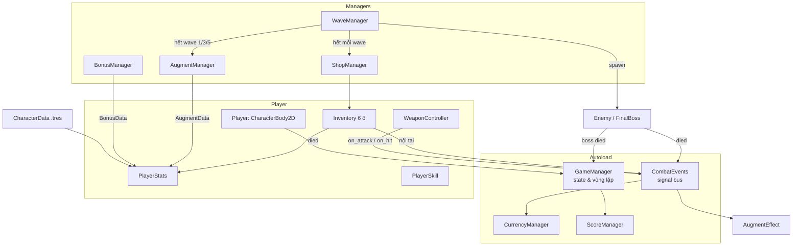
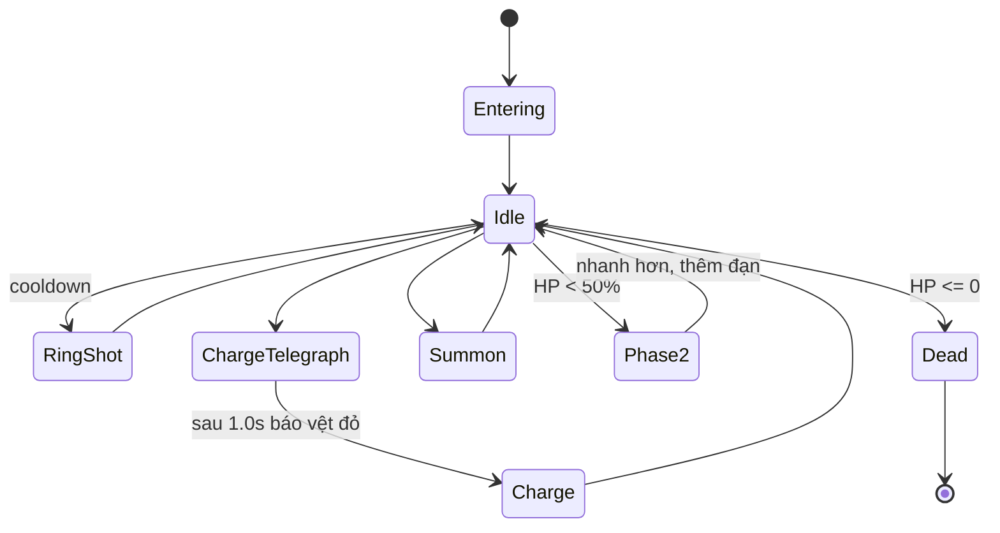
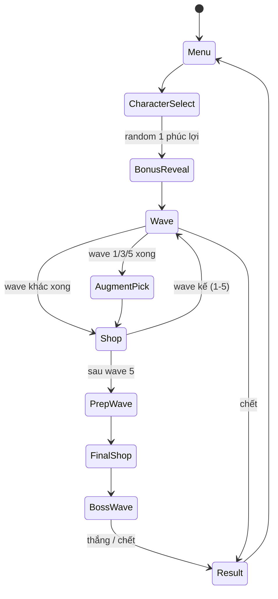

# ⚔️ ARAM MAYHEM CAMPAIGN — THIẾT KẾ HỆ THỐNG (GODOT 4 EDITION)
> **Dự án:** ARAM Mayhem Campaign (2D Top-Down Arena Roguelite / Bullet Heaven)
> **Engine:** Godot 4.x (GDScript) | **Thư mục:** `d:/Do an 2026/MTA/Godot/AramMayhemCampaign/`
> **Tài liệu tham chiếu:** [`ARAM_MAYHEM_CAMPAIGN_PLAN.md`](ARAM_MAYHEM_CAMPAIGN_PLAN.md) (kế thừa từ `ARAM_SURVIVOR_BOSS_RUSH_PLAN.md`)
>
> **Ghi chú chuyển đổi:** Plan gốc viết cho Unity (C#, ScriptableObject). Tài liệu này ánh xạ sang Godot 4: `ScriptableObject` → `Resource` (`.tres`), `static event` → `Signal` trên Autoload, `Prefab` → `PackedScene`, `Rigidbody2D` → `CharacterBody2D`, `OverlapCircle` → `Area2D`/`PhysicsShapeQuery`.

---

## 📑 MỤC LỤC
1. [Tổng quan kiến trúc](#1-tổng-quan-kiến-trúc)
2. [Cấu trúc thư mục](#2-cấu-trúc-thư-mục)
3. [Physics Layers](#3-physics-layers)
4. [Cây Scene & Node](#4-cây-scene--node)
5. [Hệ thống lõi (Core Systems)](#5-hệ-thống-lõi)
6. [Đặc tả Resource (Data-driven)](#6-đặc-tả-resource)
7. [Đặc tả các lớp GDScript](#7-đặc-tả-các-lớp-gdscript)
8. [Luồng game & State Machine](#8-luồng-game--state-machine)
9. [Công thức cân bằng](#9-công-thức-cân-bằng)
10. [UI](#10-ui)
11. [Hiệu năng](#11-hiệu-năng)
12. [Kế hoạch triển khai & kiểm thử](#12-kế-hoạch-triển-khai--kiểm-thử)

---

## 1. TỔNG QUAN KIẾN TRÚC

Nguyên tắc: **Data-driven** (mọi nội dung là `Resource`), **Event-driven** (Autoload `CombatEvents` phát signal), **Composition** (node con chuyên biệt).



---

## 2. CẤU TRÚC THƯ MỤC

```text
res://
├── project.godot
├── autoload/        game_manager.gd, combat_events.gd, currency_manager.gd, score_manager.gd
├── scenes/
│   ├── menu/        MainMenu.tscn, CharacterSelect.tscn
│   ├── game/        Game.tscn, Arena.tscn
│   ├── entities/    Player.tscn, Enemy*.tscn, FinalBoss.tscn
│   ├── weapons/     Projectile.tscn, EnemyProjectile.tscn, MeleeHitbox.tscn
│   ├── pickups/     GoldPickup.tscn
│   └── ui/          HUD, BonusRevealUI, AugmentUI, ShopUI, InventoryUI, BossHPBar, ResultUI
├── scripts/
│   ├── player/      player.gd, player_stats.gd, player_skill.gd
│   ├── weapon/      weapon_controller.gd, projectile.gd, melee_hitbox.gd
│   ├── enemy/       enemy.gd, enemy_spawner.gd, final_boss.gd
│   ├── augment/     augment_manager.gd, augment_effect.gd (+ effects/)
│   ├── items/       inventory.gd, shop_manager.gd
│   ├── managers/    wave_manager.gd, bonus_manager.gd, object_pool.gd
│   └── data/        character_data.gd, weapon_data.gd, bonus_data.gd,
│                    augment_data.gd, item_data.gd, wave_data.gd, boss_data.gd, stat_modifier.gd
├── resources/       characters/ weapons/ augments/ items/ bonuses/ waves/ bosses/
└── assets/          sprites/ audio/ fonts/
```

---

## 3. PHYSICS LAYERS

| Layer | Tên | Vai trò | Mask (va chạm với) |
| :-: | :--- | :--- | :--- |
| 1 | `World` | Tường bao đấu trường | Player, Enemy |
| 2 | `Player` | Nhân vật | World, Enemy, EnemyProjectile, Pickup |
| 3 | `Enemy` | Quái / Boss | World, PlayerProjectile, MeleeHitbox |
| 4 | `PlayerProjectile` | Đạn người chơi | Enemy |
| 5 | `EnemyProjectile` | Đạn quái/boss | Player |
| 6 | `Pickup` | Vàng rơi | Player |

Quái không va chạm lẫn nhau (tránh kẹt); tách nhau bằng lực đẩy nhẹ (separation) trong `enemy.gd`.

---

## 4. CÂY SCENE & NODE

```text
Game (Node2D)
├── Arena (TileMap/Sprite + StaticBody2D tường bao)
├── Player (CharacterBody2D)
│   ├── Sprites (AnimatedSprite2D) + HitFlash
│   ├── CollisionShape2D (Circle)
│   ├── PlayerStats (Node)
│   ├── WeaponController (Node2D)  ── DetectionArea (Area2D)
│   ├── PlayerSkill (Node)
│   ├── Inventory (Node)
│   └── Camera2D
├── Managers
│   ├── WaveManager / EnemySpawner
│   ├── BonusManager / AugmentManager / ShopManager
│   └── ObjectPool (Projectile, Enemy, Gold)
├── Projectiles (Node2D)  /  Enemies (Node2D)  /  Pickups (Node2D)
└── UI (CanvasLayer): HUD, BossHPBar, popups
```

---

## 5. HỆ THỐNG LÕI

### 5.1. StatSystem (`PlayerStats`)
Chỉ số: `MAX_HP, HP_REGEN, LIFESTEAL, AD, AP, ATTACK_SPEED, CRIT_CHANCE, CRIT_DAMAGE, ABILITY_HASTE, MOVE_SPEED, ARMOR`.

Mỗi chỉ số lưu `base`, danh sách modifier **add** và **mult**:

$$\text{Stat} = (\text{base} + \sum \text{add}) \times (1 + \sum \text{mult})$$

- `add_modifier(source: Object, stat, add, mult)` / `remove_modifiers_from(source)` — gỡ theo nguồn (Lõi, Trang bị, Phúc lợi) nên bán đồ không lỗi.
- Phát `stats_changed(stat)` để HUD cập nhật.

### 5.2. CombatEvents (Event Bus)
```gdscript
signal attack(weapon, projectile)
signal hit(target, damage, is_crit)
signal crit(target)
signal kill(enemy)
signal take_damage(amount)
signal skill_cast(skill)
signal gold_changed(total)
signal wave_started(index)
signal wave_ended(index)
```
Lõi *Feature* và trang bị nội tại kết nối signal này trong `apply()` và ngắt trong `remove()` → không sửa code lõi.

### 5.3. Vũ khí tự ngắm
`WeaponController` mỗi `0.1s` truy vấn `DetectionArea` lấy quái gần nhất; xoay nòng; khoảng cách giữa các phát bắn = `1 / ATTACK_SPEED`. Sát thương:

$$\text{Dmg} = \text{AD}\times k_{weapon}\times(\text{crit}? \; \text{CRIT\_DAMAGE}:1)$$

### 5.4. Hệ thống Phúc lợi (`BonusManager`)
- Chọn **1** `BonusData` bằng random có trọng số (`weight`), người chơi không được chọn.
- `BonusData.kind`: `STAT`, `EXTRA_REROLL`, `GOLD`, `EXTRA_AUGMENT`, `SHOP_DISCOUNT`, `GIFT_AT_WAVE`, `GOLD_MULT`.
- `apply(game)` đăng ký hiệu ứng; `GIFT_AT_WAVE` lắng nghe `wave_started`.

### 5.5. Hệ thống Lõi (`AugmentManager`)
- Mốc: sau wave **1 / 3 / 5** → Bạc / Vàng / Kim Cương. Tối đa 3 lõi (+1 nếu có Lõi Tiên Phong).
- Bốc 3 thẻ khác nhau cùng rarity (loại lõi đã sở hữu), `reroll` trừ lượt miễn phí.
- `AugmentEffect` (Resource, abstract): `apply(player)`, `remove(player)`. Con: `StatModifierEffect`, `ExtraProjectileEffect`, `BounceEffect`, `ThornsEffect`, `LowHpBerserkEffect`, `StackOnKillEffect`, `CooldownOnHitEffect`.

### 5.6. Trang bị & Shop
- `Inventory`: mảng 6 ô; `try_add(item)`, `sell(index)` hoàn **50%** giá.
- `ShopManager`: sinh **4** món theo bảng bậc/wave (Huyền thoại chỉ từ wave 4+); giá reroll:

$$\text{reroll}_n = 5 + 5n \quad(\text{wave 6 shop: giảm 50\%})$$

- Kiểm tra: đủ vàng, còn ô; phát `purchased`, `inventory_full`.
- Giá = `price × (1 − discount)` (Khách Quen −15%).

### 5.7. Kinh tế (`CurrencyManager`)
`gold` + `gold_multiplier` (Thợ Săn +25%, Wave 6 ×2). Vàng rơi là `GoldPickup`, tự hút khi trong bán kính 120px.

### 5.8. Final Boss (FSM)

Tham số hóa trong `BossData` (HP, tốc độ, cooldown từng chiêu, hệ số phase 2).

---

## 6. ĐẶC TẢ RESOURCE

| Resource | Trường chính |
| :--- | :--- |
| `CharacterData` | `name, icon, base_stats: Dictionary, buff_text, debuff_text, weapon: WeaponData, skill_id` |
| `WeaponData` | `type (PROJECTILE/MELEE/AOE), damage_scale, projectile_scene, range, pierce` |
| `BonusData` | `name, desc, kind, value, weight` |
| `AugmentData` | `name, icon, desc, rarity, effects: Array[AugmentEffect]` |
| `ItemData` | `name, icon, tier, price, modifiers: Array[StatModifier], effect: AugmentEffect` |
| `StatModifier` | `stat, add, mult` |
| `WaveData` | `duration, enemy_table: [{scene, weight}], spawn_interval, count_scale, hp_scale, gold_mult` |
| `BossData` | `hp, speed, ring_bullets, charge_speed, summon_count, phase2_threshold` |

> Thêm lõi/trang bị/phúc lợi mới = tạo file `.tres`, **không sửa code**.

---

## 7. ĐẶC TẢ CÁC LỚP GDSCRIPT

| Script | Vai trò | API chính |
| :--- | :--- | :--- |
| `GameManager` | State toàn game, chuyển scene | `start_run(character)`, `change_state(s)`, `end_run(win)` |
| `Player` | Di chuyển WASD, nhận sát thương theo Armor | `take_hit(dmg)`, `die()`, signal `hp_changed` |
| `PlayerStats` | Chỉ số động | `get_stat()`, `add_modifier()`, `remove_modifiers_from()` |
| `PlayerSkill` | Space, cooldown = `base / (1 + haste/100)` | `try_cast()` |
| `WeaponController` | Tìm mục tiêu gần nhất, bắn | `_find_nearest()`, `fire()` |
| `Projectile` | Bay, va chạm, bounce/pierce | `setup(dmg, dir, speed)` |
| `Enemy` | Đuổi theo, chạm gây dame, rơi vàng | `take_damage()`, signal `died` |
| `EnemySpawner` | Spawn rìa map theo `WaveData` | `spawn_wave(data)` |
| `WaveManager` | Timer + luồng wave | `start_wave(i)`, signal `wave_ended` |
| `AugmentManager` | Bốc/reroll lõi | `roll(rarity)`, `pick(aug)` |
| `BonusManager` | Random phúc lợi | `roll_bonus()` |
| `Inventory` / `ShopManager` | Túi đồ & cửa hàng | xem 5.6 |
| `ScoreManager` | Tính điểm, lưu `user://highscore.cfg` | `calculate()` |
| `ObjectPool` | Tái sử dụng node | `acquire(scene)`, `release(node)` |

---

## 8. LUỒNG GAME & STATE MACHINE



| Wave | Thời lượng | Đặc điểm |
| :-: | :-: | :--- |
| 1–5 | 45s | Quái tăng dần, rơi vàng |
| 6 (Prep) | 30–40s | Quái yếu & đông, vàng ×2 → Shop cuối |
| 7 | Đến khi hết | Final Boss |

Điểm: $\text{Score}=10\cdot K + T_{sống} + B_{HP} + B_{boss} + G_{dư}$.

---

## 9. CÔNG THỨC CÂN BẰNG

| Đại lượng | Công thức |
| :--- | :--- |
| Máu quái wave $w$ | $HP = HP_0 \times (1 + 0.25(w-1))$ |
| Số quái đồng thời | $N = N_0 + 4(w-1)$, giới hạn 60 |
| Giảm sát thương theo Giáp | $\text{Dmg}_{nhận} = \text{Dmg}\times\dfrac{100}{100+\text{Armor}\cdot 5}$ |
| Hồi chiêu | $CD=\dfrac{CD_0}{1+\text{Haste}/100}$ |
| Hút máu | $\text{Heal}=\text{Dmg}\times\text{LIFESTEAL}$ |

Mọi hệ số nằm trong Resource để chỉnh không cần sửa code.

---

## 10. UI

| Màn hình | Nội dung |
| :--- | :--- |
| HUD | HP, vàng, wave + timer, cooldown skill, icon lõi/trang bị |
| `BonusRevealUI` | Hiệu ứng lật thẻ phúc lợi |
| `AugmentUI` | 3 thẻ + nút Reroll (hiện lượt còn lại) |
| `ShopUI` | 4 món, Reroll, Bán, đầy ô → cảnh báo |
| `BossHPBar` | Thanh máu lớn, đổi màu phase 2 |
| `ResultUI` | Victory/Game Over, điểm, high score |

Khi mở Shop/Lõi: `get_tree().paused = true` (UI `process_mode = ALWAYS`).

---

## 11. HIỆU NĂNG
- **Object Pool** cho đạn, quái, vàng; giới hạn ~60 quái.
- Tìm mục tiêu theo timer 0.1s thay vì mỗi frame.
- Đạn dùng `Area2D` nhẹ; dọn đạn khi ra khỏi màn.

---

## 12. KẾ HOẠCH TRIỂN KHAI & KIỂM THỬ

| Milestone | Nội dung | Kiểm thử |
| :-: | :--- | :--- |
| M1 | Player + StatSystem + HP UI | Modifier add/mult đúng; gỡ theo nguồn |
| M2 | Enemy, Spawner, Wave, Arena | Quái đuổi, rơi vàng, wave kết thúc đúng giờ |
| M3 | Vũ khí AD + Pool | Bắn quái gần nhất, crit |
| M4 | Class AD, Skill, Phúc lợi | Random theo weight; 7 phúc lợi hoạt động |
| M5 | Vàng, Shop, Túi 6 ô | Mua/bán/reroll, chặn khi đầy/thiếu vàng |
| M6 | Lõi + CombatEvents | 3 lần bốc, hook không rò rỉ khi remove |
| M7 | Wave Prep + Final Boss | 3 chiêu + phase 2 chạy |
| M8 | Điểm, Win/Lose, Polish | Lưu high score, âm thanh, rung camera |
| M9 | Build & báo cáo | Export Windows, ảnh chụp, demo |
| M10 | Thêm class Bruiser/Tank/AP | Chỉ thêm `.tres` + vũ khí/skill |

**Ưu tiên khi thiếu thời gian:** Class AD + súng + Wave 1–7 + Phúc lợi + Shop 6 ô + 3 lần bốc lõi + Boss + Điểm.

