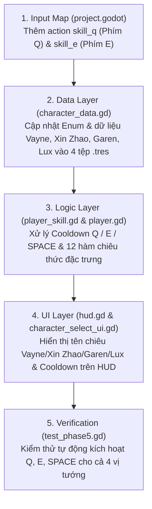

# KẾ HOẠCH XÂY DỰNG HỆ THỐNG 2 KỸ NĂNG PHỤ [Q], [E] VÀ 1 KỸ NĂNG CHÍNH [SPACE]

**Tên học phần:** Đồ án Môn học — Phát triển Trò chơi Hành động Sinh tồn 2D  
**Tên đề tài:** ARAM Mayhem Campaign (Godot Engine 4.x)  
**Mục tiêu hạng mục:** Thiết kế kiến trúc dữ liệu, cơ chế chiến đấu, giao diện hiển thị và lộ trình triển khai hệ thống 3 kỹ năng chủ động (`[Q]` - Kỹ năng Phụ 1, `[E]` - Kỹ năng Phụ 2, `[SPACE]` - Kỹ năng Chính) dựa trên nguyên mẫu 4 vị tướng biểu tượng: **Vayne (AD)**, **Xin Zhao (Đấu Sĩ)**, **Garen (Tank)** và **Lux (Pháp Sư)**.

---

## 1. MỤC TIÊU THIẾT KẾ & ĐỊNH HƯỚNG GAMEPLAY

Hiện tại, mỗi lớp nhân vật sở hữu 1 Vũ khí đánh thường tự động (Auto-Aim) và 1 Kỹ năng Chính kích hoạt bằng phím `[SPACE]`, trong khi giao diện Thanh trạng thái Đáy (MOBA Bottom HUD Dock trong `hud.gd`) đã được thiết kế sẵn cụm 4 ô biểu tượng kỹ năng `P - Q - E - SPACE`.

Việc xây dựng hệ thống **2 Kỹ năng Phụ (`[Q]` và `[E]`)** kết hợp cùng **1 Kỹ năng Chính (`[SPACE]`)** theo bộ kỹ năng của **Vayne, Xin Zhao, Garen và Lux** nhằm đạt được 4 mục tiêu trọng tâm:
1. **Tăng chiều sâu chiến thuật chủ động & Combo quen thuộc:** Người chơi có thể thực hiện các chuỗi kết hợp chiêu thức kinh điển như `Q (Nhào Lộn) -> E (Kết Án đẩy tường)` của Vayne, `E (Can Trường lao vào) -> Q (Liên Hoàn Tam Kích) -> SPACE (Bán Nguyệt Thương)` của Xin Zhao, hoặc `Q (Khóa Ánh Sáng) -> E (Quả Cầu Ánh Sáng) -> SPACE (Cầu Vồng Tối Thượng)` của Lux.
2. **Khắc họa rõ nét bản sắc 4 Lớp nhân vật (Champion Identity):** Mỗi vị tướng sở hữu cơ chế độc bản: Vayne cơ động bắn tên bạc theo phần trăm máu, Xin Zhao đột kích hất tung và quét thương chặn sát thương xa, Garen câm lặng kèm xoay kiếm phán quyết diện rộng, còn Lux trói chân và dồn sát thương tia laser xuyên bản đồ.
3. **Tối ưu hóa giá trị của chỉ số Điểm Hồi Chiêu (`Ability Haste`) và Sức Mạnh Phép Thuật (`AP`):** Khi có 3 kỹ năng chủ động cùng vận hành, các Trang bị và Lõi Nâng Cấp tăng Hồi chiêu hoặc kích hoạt hiệu ứng khi tung chiêu (như Lõi Kim Cương *Bàn Tay Ma Thuật*) sẽ phát huy tối đa sức mạnh.
4. **Đồng bộ 100% với Giao diện HUD chuẩn Liên Minh Huyền Thoại:** Các ô `[Q]`, `[E]` và `[SPACE]` trên thanh HUD đáy hiển thị tên kỹ năng và thời gian hồi chiêu độc lập theo thời gian thực.

---

## 2. THIẾT KẾ CHI TIẾT BỘ 3 KỸ NĂNG CHO 4 NHÂN VẬT

### 2.1. Lớp Nhân vật 1: Vayne — Xạ Thủ Bóng Đêm (`ad_marksman.tres`)
* **Định hướng lối chơi:** Giữ khoảng cách tối đa (`360px`), liên tục dùng `[Q]` Nhào Lộn để thả diều kết hợp kích hoạt Mũi Tên Bạc, dùng `[E]` Kết Án đẩy lùi và làm choáng quái vật áp sát, và bật `[SPACE]` Giờ Khắc Cuối Cùng để tàng hình ngắn hạn kèm bùng nổ sức mạnh công kích.

| Phím tắt | Tên Kỹ năng | Loại Kỹ năng | Hồi chiêu gốc | Cơ chế Hoạt động & Công thức Sát thương |
| :---: | :--- | :--- | :---: | :--- |
| **`[Q]`** | **Nhào Lộn & Mũi Tên Bạc** *(Tumble & Silver Bolts)* | Kỹ năng Phụ 1 (Lướt ngắn & Cường hóa đòn bắn) | `3.5 giây` | Nhào lộn nhanh một đoạn ngắn (`150px`) theo hướng di chuyển và lập tức phóng **1 Mũi Tên Bạc** cường hóa vào mục tiêu gần nhất, gây **`140% AD`** sát thương vật lý cộng thêm **sát thương chuẩn bằng `8% Máu tối đa`** của mục tiêu. |
| **`[E]`** | **Kết Án** *(Condemn)* | Kỹ năng Phụ 2 (Đạn đẩy lùi & Làm choáng) | `7.5 giây` | Bắn một mũi tên hạng nặng về phía kẻ địch gần nhất (hoặc chùm hẹp trước mặt), gây **`115% AD`** sát thương vật lý và **đẩy lùi mạnh (`Knockback 380`)**. Nếu kẻ địch va phải rìa đấu trường hoặc va vào quái vật khác, chúng chịu thêm **`100% AD`** sát thương và bị **Làm choáng `1.2 giây`**. |
| **`[SPACE]`** | **Giờ Khắc Cuối Cùng** *(Final Hour)* | Kỹ năng Chính (Cường hóa Tối thượng & Ẩn thân) | `10.0 giây` | Bước vào trạng thái Thợ Săn Bóng Đêm trong `4.5 giây`: nhận **Bất tử/Ẩn thân ngắn trong `0.8 giây`** đầu, tăng **`+35% Sức mạnh công kích (AD)`**, **`+50% Tốc độ đánh`** và **`+25% Tốc độ di chuyển`**. |

---

### 2.2. Lớp Nhân vật 2: Xin Zhao — Đấu Sĩ Tể Tướng Demacia (`bruiser.tres`)
* **Định hướng lối chơi:** Đấu sĩ xung phong tầm ngắn (`105px`), dùng `[E]` Can Trường lao thẳng vào giữa bầy quái để tăng tốc đánh, kích hoạt `[Q]` Liên Hoàn Tam Kích đâm 3 nhát liên hoàn hất tung mục tiêu, và vung thương `[SPACE]` Bán Nguyệt Thương quét văng mọi kẻ địch xung quanh đồng thời tạo vòng hộ vệ.

| Phím tắt | Tên Kỹ năng | Loại Kỹ năng | Hồi chiêu gốc | Cơ chế Hoạt động & Công thức Sát thương |
| :---: | :--- | :--- | :---: | :--- |
| **`[Q]`** | **Liên Hoàn Tam Kích** *(Three Talon Strike)* | Kỹ năng Phụ 1 (Chuỗi 3 đòn đâm & Hất tung) | `4.5 giây` | Tung liên tiếp **3 mũi thương chớp nhoáng** về phía trước (tầm `190px`, rộng `75px`), mỗi nhát gây **`70% AD`** sát thương vật lý (tổng **`210% AD`**). Nhát đâm thứ 3 tạo luồng gió **Hất tung/Làm choáng kẻ địch trong `0.75 giây`** và **giảm `1.0 giây` hồi chiêu** của kỹ năng `[E]` và `[SPACE]`. |
| **`[E]`** | **Can Trường** *(Audacious Charge)* | Kỹ năng Phụ 2 (Đột kích áp sát & Tăng tốc đánh) | `6.5 giây` | Lao thẳng tới vị trí kẻ địch gần nhất trong tầm `260px` (hoặc lướt về phía trước), phát xung kích bán kính `120px` gây **`110% AD + 60% AP`** sát thương phép, làm chậm quái vật và tăng cho Xin Zhao **`+45% Tốc độ đánh`** trong `3.5 giây`. |
| **`[SPACE]`** | **Bán Nguyệt Thương** *(Crescent Guard)* | Kỹ năng Chính (Quét thương diện rộng & Hộ vệ) | `11.0 giây` | Quét mũi thương hình vòng cung rộng bán kính `180px` quanh bản thân, gây **`160% AD + 15% Máu hiện tại của mục tiêu`** sát thương vật lý và **hất văng (`Knockback 340`)** toàn bộ kẻ địch ra rìa vòng. Trong `4.0 giây` tiếp theo, tạo **Vòng Bán Nguyệt Hộ Vệ** giúp nhận **`+35% Tốc độ di chuyển`**, **`+20% Hút máu`** và giảm sát thương nhận vào. |

---

### 2.3. Lớp Nhân vật 3: Garen — Đỡ Đòn Sức Mạnh Demacia (`tank.tres`)
* **Định hướng lối chơi:** Pháo đài tiên phong (`110px`), bật `[Q]` Đòn Quyết Định để bứt tốc áp sát bổ kiếm gây câm lặng, kích hoạt `[E]` Phán Quyết để vừa di chuyển vừa xoay đại kiếm nghiền nát đàn quái xung quanh, và kết liễu bằng `[SPACE]` Công Lý Demacia giáng đại kiếm từ bầu trời.

| Phím tắt | Tên Kỹ năng | Loại Kỹ năng | Hồi chiêu gốc | Cơ chế Hoạt động & Công thức Sát thương |
| :---: | :--- | :--- | :---: | :--- |
| **`[Q]`** | **Đòn Quyết Định** *(Decisive Strike)* | Kỹ năng Phụ 1 (Tăng tốc & Bổ kiếm Câm lặng) | `4.5 giây` | Giải trừ làm chậm, tăng **`+35% Tốc độ di chuyển`** trong `1.5 giây` và lập tức bổ đại kiếm xuống phía trước (vùng quạt `140 độ`, bán kính `150px`), gây **`145% AD + 80% Giáp`** sát thương vật lý và gây **Câm lặng/Khựng đòn (`1.0 giây`)** lên các mục tiêu trúng chiêu. |
| **`[E]`** | **Phán Quyết** *(Judgment)* | Kỹ năng Phụ 2 (Xoay kiếm diện rộng duy trì) | `7.5 giây` | Xoay tròn đại kiếm quanh thân liên tục trong **`3.0 giây`** (bán kính `155px`, Garen vẫn di chuyển xuyên vật cản). Mỗi `0.35 giây` (tổng 8 vòng xoay) gây **`45% AD + 35% Giáp`** sát thương vật lý cho toàn bộ kẻ địch xung quanh và làm giảm `25% Giáp` của chúng. |
| **`[SPACE]`** | **Công Lý Demacia** *(Demacian Justice)* | Kỹ năng Chính (Đại kiếm Kết liễu & Khiên Dũng Cảm) | `10.5 giây` | Kích hoạt giáp **Lòng Dũng Cảm** (nhận Khiên chắn bằng `12% Máu tối đa` và **giảm `50%` sát thương trong `4.0 giây`**), đồng thời triệu hồi **Thanh Đại Kiếm Ánh Sáng** khổng lồ giáng xuống mục tiêu có máu cao nhất/gần nhất (nổ lan bán kính `165px`), gây **Sát thương chuẩn bằng `150% AD + 25% lượng máu đã mất`** của mục tiêu. |

---

### 2.4. Lớp Nhân vật 4: Lux — Pháp Sư Tiểu Thư Ánh Sáng (`mage_ap.tres`)
* **Định hướng lối chơi:** Pháp sư kiểm soát và dồn sát thương tầm xa (`245px`), bắn `[Q]` Khóa Ánh Sáng để trói chân 2 kẻ địch đầu tiên, quăng `[E]` Quả Cầu Ánh Sáng làm chậm và kích nổ diện rộng, sau đó khai hỏa `[SPACE]` Cầu Vồng Tối Thượng xuyên thủng toàn bộ hàng ngũ địch.

| Phím tắt | Tên Kỹ năng | Loại Kỹ năng | Hồi chiêu gốc | Cơ chế Hoạt động & Công thức Sát thương |
| :---: | :--- | :--- | :---: | :--- |
| **`[Q]`** | **Khóa Ánh Sáng** *(Light Binding)* | Kỹ năng Phụ 1 (Cầu ánh sáng Trói chân kép) | `4.0 giây` | Bắn một quả cầu ánh sáng bay xa `340px` về hướng mục tiêu. Quả cầu xuyên qua và **Trói chân (`Root` - khóa di chuyển) tối đa 2 kẻ địch đầu tiên** trúng phải trong `1.5 giây`, đồng thời gây **`145% AP`** sát thương phép và đánh dấu *Chói Lóa*. |
| **`[E]`** | **Quả Cầu Ánh Sáng** *(Lucent Singularity)* | Kỹ năng Phụ 2 (Vùng làm chậm & Kích nổ Ánh sáng) | `6.0 giây` | Phóng dị điểm ánh sáng tới vị trí đám đông kẻ địch trong tầm `280px`, tạo vùng trường lực bán kính `130px` **làm chậm `40%`** trong `0.6 giây` rồi phát nổ rực rỡ, gây **`185% AP`** sát thương phép diện rộng và đẩy nhẹ quái vật ra ngoài. |
| **`[SPACE]`** | **Cầu Vồng Tối Thượng** *(Final Spark)* | Kỹ năng Chính (Tia Laser Ánh sáng Xuyên thấu) | `8.5 giây` | Sau `0.25 giây` tụ sáng, khai hỏa một **Đại Tia Laser Cầu Vồng** cực đại dài `520px` (rộng `90px`) xuyên qua toàn bộ màn hình theo hướng mục tiêu, gây **`300% AP`** sát thương phép hủy diệt. Nếu kẻ địch đang chịu dấu ấn từ `[Q]` hoặc `[E]`, chúng nhận thêm **`+25%` sát thương cộng hưởng**. |

---

## 3. KIẾN TRÚC KỸ THUẬT & CẤU TRÚC MÃ NGUỒN TRIỂN KHAI

Để tích hợp bộ kỹ năng của **Vayne, Xin Zhao, Garen và Lux** vào kiến trúc hiện hành một cách sạch sẽ, dễ bảo trì và không phá vỡ tính tương thích của các bài kiểm thử tự động, quá trình xây dựng được chia thành **5 Giai đoạn Kỹ thuật (5 Steps)**:

### Bước 1: Mở rộng Bảng Ánh xạ Phím Đầu vào (`project.godot`)
* Giữ nguyên action `skill` (`KEY_SPACE`) cho Kỹ năng Chính (Chiêu cuối `[R/SPACE]`).
* Đăng ký thêm 2 Input Action mới trong `project.godot` (và tự động khởi tạo an toàn trong `player.gd` nếu chưa có):
  * `skill_q`: Phím vật lý `Q` (`KEY_Q`).
  * `skill_e`: Phím vật lý `E` (`KEY_E`).

### Bước 2: Mở rộng Lớp Tài nguyên Nhân vật (`character_data.gd` & 4 tệp `.tres`)
* Trong `character_data.gd`, định nghĩa các kiểu liệt kê ánh xạ trực tiếp với bộ chiêu của 4 vị tướng:
  * `enum SubSkillQType { VAYNE_TUMBLE, XINZHAO_THREE_TALON, GAREN_DECISIVE_STRIKE, LUX_LIGHT_BINDING }`
  * `enum SubSkillEType { VAYNE_CONDEMN, XINZHAO_AUDACIOUS_CHARGE, GAREN_JUDGMENT, LUX_LUCENT_SINGULARITY }`
  * `enum SkillType { VAYNE_FINAL_HOUR, XINZHAO_CRESCENT_GUARD, GAREN_DEMACIAN_JUSTICE, LUX_FINAL_SPARK }`
* Bổ sung nhóm thuộc tính `@export_group("Sub Skills (Q & E)")`:
  * `skill_q_name: String`, `skill_q_description: String`, `skill_q_type: SubSkillQType`, `skill_q_cooldown: float`
  * `skill_e_name: String`, `skill_e_description: String`, `skill_e_type: SubSkillEType`, `skill_e_cooldown: float`
* Cập nhật đầy đủ tên tướng và bộ kỹ năng vào 4 tệp tài nguyên:
  * `ad_marksman.tres` $\rightarrow$ **Vayne — Xạ Thủ Bóng Đêm**
  * `bruiser.tres` $\rightarrow$ **Xin Zhao — Tể Tướng Demacia**
  * `tank.tres` $\rightarrow$ **Garen — Sức Mạnh Demacia**
  * `mage_ap.tres` $\rightarrow$ **Lux — Tiểu Thư Ánh Sáng**

### Bước 3: Nâng cấp Bộ Thực thi Kỹ năng (`player_skill.gd` & `player.gd`)
* Trong `player_skill.gd`:
  * Bổ sung tín hiệu:
    * `signal cooldown_q_updated(remaining: float, total: float)`
    * `signal cooldown_e_updated(remaining: float, total: float)`
  * Quản lý 2 biến đếm thời gian hồi chiêu độc lập: `cooldown_q_remaining: float = 0.0` và `cooldown_e_remaining: float = 0.0`.
  * Áp dụng chung công thức giảm hồi chiêu theo chỉ số `ABILITY_HASTE`:
    $$CD_{\text{thực tế}} = \max\left(0.5, \frac{CD_{\text{gốc}}}{1.0 + \frac{\text{Ability Haste}}{100.0}}\right)$$
  * Xây dựng phương thức `try_cast_q() -> bool`, `try_cast_e() -> bool` và `try_cast() -> bool`:
    * Khi kích hoạt thành công, phát tín hiệu `CombatEvents.skill_cast.emit(...)` để kích hoạt các hiệu ứng Lõi nâng cấp (ví dụ: *Bàn Tay Ma Thuật*).
    * Dựng hiệu ứng hình học 2D nội sinh (`Polygon2D`, `Line2D`, `Tween`) chuẩn xác theo hiệu ứng thị giác của từng tướng:
      * **Vayne:** Bóng mờ lướt Nhào Lộn kèm vòng bạc 3 tầng (`[Q]`), mũi tên bạc khổng lồ đẩy lùi (`[E]`), hào quang dơi tím đen (`[SPACE]`).
      * **Xin Zhao:** 3 mũi thương ánh bạc đâm liên hoàn (`[Q]`), vệt lao đột kích xanh lam (`[E]`), nhát quét thương bán nguyệt 360 độ kèm vòng khiên vàng (`[SPACE]`).
      * **Garen:** Nhát chém ánh kim câm lặng (`[Q]`), vòng xoáy đại kiếm xoay liên tục 3 giây quanh người (`[E]`), thanh đại kiếm khổng lồ giáng từ trên cao xuống (`[SPACE]`).
      * **Lux:** Quả cầu ánh sáng kèm vòng xích trói chân vàng kim (`[Q]`), quả cầu tinh tú nở rộng rồi phát nổ (`[E]`), đại tia laser cầu vồng xuyên bản đồ (`[SPACE]`).
* Trong `player.gd` (`_physics_process`):
  * Kiểm tra `Input.is_action_just_pressed("skill_q")` $\rightarrow$ gọi `skill.try_cast_q()`.
  * Kiểm tra `Input.is_action_just_pressed("skill_e")` $\rightarrow$ gọi `skill.try_cast_e()`.
  * Kiểm tra `Input.is_action_just_pressed("skill")` $\rightarrow$ gọi `skill.try_cast()`.

### Bước 4: Đồng bộ Giao diện Thanh Kỹ năng MOBA (`hud.gd` & `character_select_ui.gd`)
* Trong `hud.gd`:
  * Kết nối tín hiệu `cooldown_q_updated` và `cooldown_e_updated` từ `player.skill` vào hàm cập nhật 2 ô kỹ năng `[Q]` và `[E]` trên Thanh HUD Đáy.
  * Hiển thị trực quan trạng thái `SẴN SÀNG` (viền sáng màu theo hệ tướng) hoặc đếm ngược số giây hồi chiêu (`1.8s`, nền tối) kèm thanh năng lượng/tiến trình bên dưới.
* Trong `character_select_ui.gd`:
  * Cập nhật phần mô tả thẻ chọn tướng để liệt kê rõ danh xưng **Vayne, Xin Zhao, Garen, Lux** cùng cả 3 kỹ năng `[Q]`, `[E]` và `[SPACE]` giúp người chơi nắm bắt toàn diện bộ chiêu thức trước khi xuất kích.

### Bước 5: Kiểm thử Tự động & Cân bằng Độ khó (`test_phase5.gd`)
* Mở rộng kịch bản kiểm thử `test_phase5.gd` để kiểm tra:
  * Khởi tạo đúng thông số `skill_q_cooldown`, `skill_e_cooldown` của cả 4 vị tướng.
  * Thực thi `try_cast_q()`, `try_cast_e()` và `try_cast()` không phát sinh lỗi runtime và đặt bộ đếm hồi chiêu chính xác theo `Ability Haste`.

---

## 4. KIẾN TRÚC NODE NHÂN VẬT RIÊNG BIỆT (MODULAR CHARACTER SCENE NODES)

Để thể hiện rõ ngoại hình đặc trưng của **Vayne, Xin Zhao, Garen và Lux** và cho phép thêm bất kỳ vị tướng mới nào về sau mà không bị bó buộc vào một tệp `Player.tscn` duy nhất, dự án sử dụng kiến trúc **Node Scene Nhân vật Độc lập**:

### 4.1. Danh sách 4 Node Scene Nhân vật Hiện có
Mỗi vị tướng sở hữu một tệp Scene `.tscn` riêng biệt (nằm trong nhánh `scenes/entities/player/`) với cấu trúc nút hình học (`Visuals`) đặc trưng:
1. **`PlayerAD.tscn` (Vayne — Xạ Thủ Bóng Đêm):** Trang bị nút `TacticalCape` (Áo choàng thợ săn đêm phía sau), `HextechVisor` (Kính ngắm đỏ/xanh săn đêm phía trước) và tự động nạp `lol_ad_marksman.png` cùng Nỏ Bạc `weapon_ad_crossbow.png`.
2. **`PlayerBruiser.tscn` (Xin Zhao — Tể Tướng Demacia):** Kích thước thân săn chắc (`radius = 17.0`), trang bị 2 giáp vai `LeftPauldron`, `RightPauldron` và huy hiệu chiến thần Demacia `WarCrest` mạ vàng.
3. **`PlayerTank.tscn` (Garen — Sức Mạnh Demacia):** Thân hình hộ pháp đồ sộ (`radius = 18.5`), bọc khung giáp 8 cạnh `HeavyArmorPlate` và lõi hộ tâm Demacia `AegisCore` ở giữa ngực.
4. **`PlayerMage.tscn` (Lux — Tiểu Thư Ánh Sáng):** Trang bị vương miện ánh sáng `ArcaneCrown` và cụm nút `FloatingOrbs` gồm **3 Viên Ngọc Ánh Sáng** tự động xoay tròn quanh thân trong thời gian thực.

### 4.2. Cơ chế Khởi tạo Động trong `game.gd` và `character_data.gd`
* Lớp dữ liệu `character_data.gd` có thuộc tính `@export var character_scene_path: String`.
* Khi vào trận (`game.gd`), phương thức `_spawn_selected_character_node()` tự động đọc `character_scene_path` của vị tướng được chọn, khởi tạo đúng Scene `.tscn` riêng của vị tướng đó và gắn kết với toàn bộ hệ thống `HUD`, `ShopUI`, `Inventory`, `AugmentManager`.

### 4.3. Quy trình 3 Bước để Thêm Tướng Mới trong Tương lai (Ví dụ: Zed Sát Thủ, Yasuo Đấu Sĩ...)
1. **Tạo Node Scene mới:** Nhân bản (Duplicate) một Scene có sẵn (ví dụ `PlayerAD.tscn` thành `PlayerZed.tscn`), mở trong Godot Editor để tự do vẽ thêm chi tiết ngoại hình, gắn `AnimatedSprite2D`, `GPUParticles2D` hoặc viết script riêng kế thừa từ `Player`.
2. **Tạo Tệp Chỉ số `.tres` mới:** Tạo `assassin_zed.tres` từ lớp `CharacterData`, điền đường dẫn `character_scene_path` trỏ tới `PlayerZed.tscn`, chọn vũ khí khởi đầu và cấu hình bộ kỹ năng `Q - E - SPACE`.
3. **Đăng ký vào Màn hình Chọn Tướng:** Thêm đường dẫn tệp `.tres` mới vào danh sách trong `character_select_ui.gd` để hiển thị thẻ chọn tướng mới.
