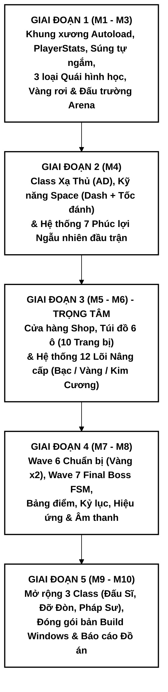

# QUY TRÌNH PHÁT TRIỂN TỪNG GIAI ĐOẠN CHUẨN (STANDARD PHASED DEVELOPMENT PLAN)

- **Dự án:** ARAM Mayhem Campaign
- **Thư mục mã nguồn Godot:** `d:/Do an 2026/MTA/Godot/AramMayhemCampaign/amc-project/`
- **Engine:** Godot 4.x (GDScript, GL Compatibility)
- **Tài liệu gốc đối chiếu:**
  - `ARAM_MAYHEM_CAMPAIGN_PLAN.md` (Đặc tả Game Design & Phạm vi MVP)
  - `ARAM_SURVIVOR_SYSTEM_DESIGN_GODOT.md` (Kiến trúc Hệ thống Godot 4)
  - `ARC_AssetsDocument.md` (Định hướng Đồ họa Hình học Nội sinh & Tài nguyên)

---

## MỤC LỤC
1. [Chiến lược và Nguyên tắc Phát triển](#1-chiến-lược-và-nguyên-tắc-phát-triển)
2. [Giai đoạn 1: Khởi tạo Nền tảng, Hệ thống Chỉ số Động & Chiến đấu Cốt lõi (M1 - M3)](#2-giai-đoạn-1-khởi-tạo-nền-tảng-hệ-thống-chỉ-số-động--chiến-đấu-cốt-lõi-m1---m3)
3. [Giai đoạn 2: Lớp Nhân vật Xạ Thủ (AD), Kỹ năng Chủ động & Phúc lợi Khởi đầu (M4)](#3-giai-đoạn-2-lớp-nhân-vật-xạ-thủ-ad-kỹ-năng-chủ-động--phúc-lợi-khởi-đầu-m4)
4. [Giai đoạn 3: Hệ thống Kinh tế, Cửa hàng 6 Ô & Lõi Nâng cấp (M5 - M6)](#4-giai-đoạn-3-hệ-thống-kinh-tế-cửa-hàng-6-ô--lõi-nâng-cấp-m5---m6)
5. [Giai đoạn 4: Đợt Chuẩn bị (Wave 6), Trùm Cuối FSM (Wave 7) & Hoàn thiện (M7 - M8)](#5-giai-đoạn-4-đợt-chuẩn-bị-wave-6-trùm-cuối-fsm-wave-7--hoàn-thiện-m7---m8)
6. [Giai đoạn 5: Mở rộng 3 Lớp Nhân vật, Đóng gói & Báo cáo Đồ án (M9 - M10)](#6-giai-đoạn-5-mở-rộng-3-lớp-nhân-vật-đóng-gói--báo-cáo-đồ-án-m9---m10)
7. [Bảng Kiểm soát Tiến độ & Phương án Dự phòng (Fallback Matrix)](#7-bảng-kiểm-soát-tiến-độ--phương-án-dự-phòng-fallback-matrix)

---

## 1. CHIẾN LƯỢC VÀ NGUYÊN TẮC PHÁT TRIỂN

### 1.1. Mô hình phát triển: Lát cắt dọc (Vertical Slice) trước, Mở rộng ngang (Horizontal Expansion) sau
Thay vì viết đồng loạt tất cả các lớp nhân vật, vũ khí và giao diện cùng lúc (dễ dẫn đến lỗi phụ thuộc chéo và không thể chạy thử), dự án được chia thành **5 Giai đoạn tuần tự**:
1. **Xây dựng Khung xương & Vòng lặp bắn quái cơ bản (Giai đoạn 1):** Giúp trò chơi chạy được ngay từ ngày đầu tiên.
2. **Hoàn thiện trọn vẹn 1 ván chơi từ đầu đến cuối với lớp nhân vật Xạ Thủ - AD (Giai đoạn 2, 3, 4):** Kiểm chứng toàn bộ cơ chế Phúc lợi, Lõi nâng cấp, Cửa hàng 6 ô, Wave Chuẩn bị và Final Boss.
3. **Mở rộng 3 lớp nhân vật còn lại (Đấu Sĩ, Đỡ Đòn, Pháp Sư) dựa trên nền tảng Data-Driven (Giai đoạn 5):** Chỉ cần thêm tệp dữ liệu `.tres` và biến thể vũ khí mà không phải sửa đổi hệ thống lõi.

### 1.2. Ba quy tắc kỹ thuật bắt buộc
1. **Quy tắc "Luôn Chạy Được (`F5` Playable)":** Kết thúc mỗi giai đoạn, dự án bắt buộc phải biên dịch không lỗi và chạy thử trực tiếp được trên Godot Editor bằng phím `F5`.
2. **Quy tắc Đồ họa Hình học Nội sinh (In-Engine Procedural Geometry):** Toàn bộ Nhân vật, Vũ khí, Quái, Boss, Đạn và Vàng đều được dựng bằng `MeshInstance2D` (`SphereMesh`, `BoxMesh`, `PrismMesh`) hoặc `Polygon2D` kết hợp thuộc tính `modulate` và hiệu ứng `Tween` theo đúng đặc tả trong `ARC_AssetsDocument.md`. Không phụ thuộc vào việc chờ đợi hình ảnh bên ngoài.
3. **Quy tắc Tách biệt Dữ liệu và Sự kiện (Data-Driven & Event-Driven):**
   - Mọi thông số của Nhân vật, Vũ khí, Phúc lợi, Lõi, Trang bị, Đợt quái và Boss đều kế thừa từ lớp `Resource`.
   - Mọi tương tác chiến đấu (`attack`, `hit`, `crit`, `kill`, `take_damage`, `skill_cast`) đều đi qua Autoload `CombatEvents` để các Lõi và Trang bị tự động đăng ký lắng nghe mà không làm rối mã nguồn nhân vật.

### 1.3. Sơ đồ lộ trình 5 Giai đoạn

---

## 2. GIAI ĐOẠN 1: KHỞI TẠO NỀN TẢNG, HỆ THỐNG CHỈ SỐ ĐỘNG & CHIẾN ĐẤU CỐT LÕI (M1 - M3)

### 2.1. Mục tiêu giai đoạn
Thiết lập toàn bộ cấu trúc thư mục chuẩn trong `amc-project`, cấu hình vật lý, các Singleton (Autoload), hệ thống chỉ số động `PlayerStats`, nhân vật di chuyển bắn súng tự động vào quái gần nhất, quái đuổi theo người chơi, rơi vàng khi bị tiêu diệt và bộ đếm thời gian đợt đấu (Wave).

### 2.2. Danh mục công việc & Tệp cần xây dựng

#### Bước 1.1: Cấu hình `project.godot`
- **Cửa sổ hiển thị (Display):** Độ phân giải `1280x720`, chế độ co giãn `canvas_items`, tỉ lệ `expand`.
- **Ánh xạ phím (Input Map):**
  - `move_left` (Phím `A`, `Left`), `move_right` (Phím `D`, `Right`), `move_up` (Phím `W`, `Up`), `move_down` (Phím `S`, `Down`).
  - `skill` (Phím `Space`).
  - `pause` (Phím `Escape`).
- **6 Lớp Vật lý 2D (2D Physics Layers):**
  - Layer 1: `World` (Tường bao đấu trường)
  - Layer 2: `Player` (Nhân vật người chơi)
  - Layer 3: `Enemy` (Quái vật & Boss)
  - Layer 4: `PlayerProjectile` (Đạn người chơi)
  - Layer 5: `EnemyProjectile` (Đạn của Quái/Boss)
  - Layer 6: `Pickup` (Vật phẩm Vàng rơi)
- **Đăng ký 4 Autoload (Singleton):**
  1. `CombatEvents` (`res://autoload/combat_events.gd`)
  2. `CurrencyManager` (`res://autoload/currency_manager.gd`)
  3. `ScoreManager` (`res://autoload/score_manager.gd`)
  4. `GameManager` (`res://autoload/game_manager.gd`)

#### Bước 1.2: Xây dựng các lớp dữ liệu gốc (`res://scripts/data/`)
1. `stat_modifier.gd` (`class_name StatModifier extends Resource`):
   - Định nghĩa enum `StatType`: `MAX_HP`, `HP_REGEN`, `LIFESTEAL`, `AD`, `AP`, `ATTACK_SPEED`, `CRIT_CHANCE`, `CRIT_DAMAGE`, `ABILITY_HASTE`, `MOVE_SPEED`, `ARMOR`.
   - Lưu trữ `stat: StatType`, `add: float`, `mult: float`.
2. `weapon_data.gd` (`class_name WeaponData extends Resource`):
   - Thuộc tính: `weapon_name`, `weapon_type` (`PROJECTILE`, `MELEE`, `AOE`), `damage_scale`, `base_range`, `projectile_speed`, `pierce_count`, `projectile_color`.
3. `wave_data.gd` (`class_name WaveData extends Resource`):
   - Thuộc tính: `wave_index`, `duration` (mặc định `45.0s`), `spawn_interval`, `max_enemies` (tối đa `60`), `hp_scale`, `gold_multiplier`, tỷ lệ xuất hiện các loại quái.

#### Bước 1.3: Hệ thống Chỉ số Động & Nhân vật (`res://scripts/player/` & `res://scenes/entities/Player.tscn`)
1. `player_stats.gd` (`class_name PlayerStats extends Node`):
   - Lưu bảng chỉ số gốc `base_stats` và danh sách modifier theo nguồn `source`.
   - Công thức tính chỉ số thực tế:
     $$\text{Stat} = (\text{base} + \sum \text{add}) \times (1 + \sum \text{mult})$$
   - Cung cấp phương thức `get_stat(stat_type)`, `add_modifier(source, stat_type, add_val, mult_val)`, `remove_modifiers_from(source)` và phát tín hiệu `stats_changed(stat_type)`.
2. `player.gd` & `Player.tscn` (`CharacterBody2D`):
   - **Tạo hình học (`ARC_AssetsDocument.md`):** Node `Visuals` gồm thân chính `MeshInstance2D` (`SphereMesh` bán kính 16, màu Vàng cam cho AD) và 2 tay `MeshInstance2D` (`BoxMesh` 8x8).
   - **Cơ chế chiến đấu & sinh tồn:**
     - Di chuyển 8 hướng theo `MOVE_SPEED`, hồi máu mỗi giây theo `HP_REGEN`.
     - Nhận sát thương giảm trừ theo Giáp (`ARMOR`):
       $$\text{Dmg}_{\text{nhận}} = \text{Dmg} \times \frac{100}{100 + \text{ARMOR} \times 5}$$
     - Thời gian bất tử ngắn (`0.4s`) sau khi bị chạm kèm hiệu ứng nháy trắng (`Tween` modulate).
     - Hút máu khi gây sát thương (`LIFESTEAL`) thông qua kết nối với `CombatEvents.hit`.

#### Bước 1.4: Hệ thống Vũ khí Tự ngắm & Đạn (`res://scripts/weapon/` & `res://scenes/weapons/`)
1. `object_pool.gd` (`class_name ObjectPool extends Node`):
   - Quản lý tái sử dụng đối tượng (`acquire`, `release`) cho Đạn người chơi, Đạn quái, Quái vật và Vàng rơi.
2. `weapon_controller.gd` (`class_name WeaponController extends Node2D`):
   - Vẽ hình khẩu súng bằng `MeshInstance2D` (`BoxMesh` chữ nhật dài màu xám thép).
   - Mỗi `0.1s` quét `DetectionArea` (`Area2D`) để khóa mục tiêu `Enemy` gần nhất trong tầm bắn.
   - Tự động xoay nòng súng hướng về mục tiêu và khai hỏa theo chu kỳ `1.0 / ATTACK_SPEED`.
   - Tạo hiệu ứng giật lùi nòng súng (`Tween` vị trí cục bộ) mỗi khi bắn.
   - Tính toán sát thương và chí mạng:
     $$\text{Dmg} = \text{AD} \times k_{\text{weapon}} \times (\text{is\_crit} \ ? \ \text{CRIT\_DAMAGE} : 1.0)$$
   - Phát tín hiệu `CombatEvents.attack.emit(self, projectile)`.
3. `projectile.gd` & `Projectile.tscn` (`Area2D`):
   - Hình dạng `BoxMesh` nhỏ màu vàng sáng.
   - Hỗ trợ xuyên mục tiêu (`pierce_count`), nảy mục tiêu (`bounce_count` phục vụ cho Lõi Đạn Nảy ở Giai đoạn 3), tự thu hồi về Pool khi hết tầm bay.

#### Bước 1.5: Đấu trường, 3 Loại Quái, Vật phẩm Vàng & Quản lý Đợt (`res://scripts/enemy/`, `res://scripts/managers/`)
1. `Arena.tscn`:
   - Sàn đấu kích thước `1600x1000` có lưới tọa độ trực quan và 4 bức tường bao `StaticBody2D` (Layer 1 `World`).
2. `enemy.gd` & 3 biến thể Quái vật:
   - **Quái bộ cơ bản (`EnemyBasic.tscn`):** `SphereMesh` màu Đỏ nhạt, đuổi theo người chơi, gây sát thương va chạm.
   - **Quái tốc độ (`EnemyFast.tscn`):** `SphereMesh` màu Vàng nhỏ hơn 20%, tốc độ chạy nhanh, máu thấp.
   - **Quái bắn xa (`EnemyRanged.tscn`):** `BoxMesh` hình vuông màu Xanh lục, giữ khoảng cách và bắn `EnemyProjectile` về phía người chơi.
   - Áp dụng lực đẩy tách đàn nhẹ (`separation force`) để các quái không chồng khít lên nhau.
3. `gold_pickup.gd` & `GoldPickup.tscn` (`Area2D`):
   - Hình thoi `PrismMesh` màu vàng chanh; tự động bay hút vào người chơi khi vào bán kính `120px`, cộng vàng qua `CurrencyManager.add_gold(amount)`.
4. `enemy_spawner.gd` & `wave_manager.gd`:
   - Sinh quái tại các vị trí ngẫu nhiên dọc rìa đấu trường, có dấu cảnh báo nhỏ (`0.5s`) trước khi quái xuất hiện.
   - Tăng máu quái theo công thức:
     $$HP_w = HP_0 \times (1 + 0.25 \times (w - 1))$$
5. `HUD.tscn` & `Game.tscn`:
   - Hiển thị Thanh máu (`HP / Max HP`), Số vàng hiện có, Số thứ tự Đợt (`Wave 1/7`) và Đồng hồ đếm ngược.

### 2.3. Tiêu chí nghiệm thu Giai đoạn 1 (Definition of Done)
- [ ] Nhấn `F5` mở vào `Game.tscn`, nhân vật di chuyển mượt trong lồng đấu trường, không đi xuyên tường.
- [ ] Súng tự động xoay về phía con quái gần nhất và xả đạn, có hiệu ứng giật nòng súng.
- [ ] Cả 3 loại quái (Đỏ, Vàng, Xanh lục) xuất hiện theo đợt, đuổi theo người chơi, bị bắn nổ và rơi ra Vàng.
- [ ] Người chơi lại gần Vàng tự động hút vào và tăng bộ đếm Vàng trên HUD; đồng hồ đếm ngược Wave hoạt động chính xác.

---

## 3. GIAI ĐOẠN 2: LỚP NHÂN VẬT XẠ THỦ (AD), KỸ NĂNG CHỦ ĐỘNG & PHÚC LỢI KHỞI ĐẦU (M4)

### 3.1. Mục tiêu giai đoạn
Hoàn thiện hồ sơ dữ liệu cho lớp nhân vật đầu tiên (**Xạ Thủ - AD**), lập trình kỹ năng chủ động bằng phím `Space` (Lướt + Tăng tốc đánh) và hệ thống phát ngẫu nhiên **1 trong 7 Phúc lợi đầu trận** kèm hiệu ứng giao diện lật thẻ.

### 3.2. Danh mục công việc & Tệp cần xây dựng

#### Bước 2.1: Đặc tả Dữ liệu Nhân vật (`res://scripts/data/character_data.gd` & `res://resources/characters/`)
- Xây dựng `CharacterData` lưu trữ: `id`, `display_name`, `body_color`, `base_stats: Dictionary`, `buff_description`, `debuff_description`, `starting_weapon: WeaponData`, `skill_id: String`, `skill_cooldown: float`, `skill_description: String`.
- Tạo tài nguyên `ad_marksman.tres` (Xạ Thủ):
  - Buff nền: `+15% Tốc độ đánh, +10% Tỷ lệ chí mạng`.
  - Debuff nền: `-15% Máu tối đa`.
  - Vũ khí khởi đầu: Súng trường tự động (`gun_ad.tres`).

#### Bước 2.2: Kỹ năng Chủ động của Nhân vật (`res://scripts/player/player_skill.gd`)
- Xử lý phím `Space` (`skill` action):
  - Thời gian hồi chiêu thực tế tính theo Điểm hồi kỹ năng (`ABILITY_HASTE`):
    $$CD = \frac{CD_0}{1 + \text{ABILITY\_HASTE} / 100}$$
  - Kỹ năng Xạ Thủ (**Lướt Chiến Thuật - Tactical Dash**): Lướt nhanh một đoạn theo hướng di chuyển (hoặc hướng súng nếu đứng yên), miễn nhiễm sát thương trong `0.2s` khi lướt, đồng thời cộng modifier tạm thời `+50% ATTACK_SPEED` trong `3.0s`.
  - Phát tín hiệu `CombatEvents.skill_cast.emit(skill_id)` (để hỗ trợ các Lõi Kim Cương ở Giai đoạn 3) và hiển thị thanh hồi chiêu trên HUD.

#### Bước 2.3: Hệ thống 7 Phúc lợi Đầu trận (`res://scripts/data/bonus_data.gd` & `res://scripts/managers/bonus_manager.gd`)
- Định nghĩa `BonusData` với enum `BonusKind` và trọng số xác suất `weight`:
  1. **Vé May Mắn (`EXTRA_REROLL`):** Cộng `+2` lượt Reroll Lõi miễn phí.
  2. **Túi Tiền (`STARTING_GOLD`):** Cộng `+100` Vàng ngay đầu Wave 1.
  3. **Lõi Tiên Phong (`EXTRA_AUGMENT`):** Mở bảng chọn ngay `1` Lõi Bạc trước khi bắt đầu Wave 1 (tổng cộng sở hữu tối đa 4 Lõi).
  4. **Trái Tim Dũng Sĩ (`MAX_HP_BUFF`):** Cộng `+30%` Máu tối đa vào `PlayerStats`.
  5. **Khách Quen (`SHOP_DISCOUNT`):** Giảm `15%` giá mua mọi trang bị trong Shop.
  6. **Quà Đợt 3 (`GIFT_AT_WAVE_3`):** Lắng nghe tín hiệu `CombatEvents.wave_started(3)` để tặng miễn phí 1 trang bị ngẫu nhiên vào túi đồ.
  7. **Thợ Săn Tiền Thưởng (`GOLD_MULTIPLIER`):** Tăng `+25%` lượng vàng rơi ra từ quái trong toàn bộ ván đấu.

#### Bước 2.4: Giao diện Chọn Nhân vật & Lật thẻ Phúc lợi (`res://scenes/menu/CharacterSelect.tscn`, `res://scenes/ui/BonusRevealUI.tscn`)
- Màn hình hiển thị thông tin lớp nhân vật Xạ Thủ (và 3 ô chờ cho các class mở rộng ở Giai đoạn 5).
- Ngay khi vào trận, tạm dừng đấu trường (`get_tree().paused = true`), hiển thị thẻ bài Phúc lợi xoay lật bằng `Tween` để công bố Phúc lợi ngẫu nhiên mà hệ thống phát cho người chơi.

### 3.3. Tiêu chí nghiệm thu Giai đoạn 2 (Definition of Done)
- [ ] Vào ván mới, giao diện lật thẻ ngẫu nhiên 1 trong 7 Phúc lợi và áp dụng đúng hiệu ứng (ví dụ: nhận Túi Tiền lập tức có 100 Vàng; nhận Trái Tim Dũng Sĩ máu tối đa tăng 30%).
- [ ] Nhấn phím `Space`, Xạ Thủ lướt nhanh, bắn nhanh hơn rõ rệt trong 3 giây và đồng hồ hồi chiêu trên HUD đếm ngược chính xác.

---

## 4. GIAI ĐOẠN 3: HỆ THỐNG KINH TẾ, CỬA HÀNG 6 Ô & LÕI NÂNG CẤP (M5 - M6)

> **Lưu ý quan trọng:** Đây là giai đoạn cốt lõi nhất của đồ án, thể hiện rõ nhất kiến trúc **Data-Driven (`Resource`)** kết hợp **Event-Driven (`CombatEvents`)**.

### 4.1. Mục tiêu giai đoạn
Xây dựng hoàn chỉnh vòng lặp nâng cấp sức mạnh giữa các đợt đấu: Hệ thống Túi đồ 6 ô, Cửa hàng 10 Trang bị (Mua, Bán hoàn tiền 50%, Reroll tăng giá) và Hệ thống bốc 12 Lõi Nâng cấp (Bạc / Vàng / Kim Cương) sau các Wave 1, 3, 5.

### 4.2. Danh mục công việc & Tệp cần xây dựng

#### Bước 3.1: Hệ thống Túi đồ 6 Ô & 10 Trang bị (`res://scripts/items/inventory.gd`, `res://scripts/data/item_data.gd`)
- `Inventory`: Quản lý mảng tối đa `6` trang bị.
  - Khi thêm trang bị (`try_add(item)`): Tự động gắn toàn bộ `StatModifier` và kích hoạt hiệu ứng nội tại (nếu có) vào `PlayerStats` / `CombatEvents`.
  - Khi bán trang bị (`sell_at(index)`): Gỡ chính xác modifier của riêng ô trang bị đó thông qua `remove_modifiers_from(slot_source)` và hoàn lại `50%` giá gốc qua `CurrencyManager`.
- Tạo đủ **10 Trang bị (`res://resources/items/`)** chia theo 3 bậc:
  - **Bậc Thường (Giá 30 - 35 Vàng):** *Kiếm Dài (+10 AD)*, *Dao Găm (+12% Tốc đánh)*, *Áo Choàng Tím (+10% Chí mạng)*, *Giày Nhanh Nhẹn (+10% Tốc chạy)*, *Áo Vải (+5 Giáp)*.
  - **Bậc Hiếm (Giá 80 - 90 Vàng):** *Huyết Kiếm (+15 AD, +10% Hút máu)*, *Cung Xanh (Mỗi đòn bắn thứ 3 gây thêm sát thương chuẩn)*, *Đại Bác Liên Thanh (+20% Tốc đánh, +25% Tầm bắn)*.
  - **Bậc Huyền Thoại (Giá 150 - 160 Vàng, chỉ mở khóa từ Wave 4 trở đi):** *Vô Cực Kiếm (+30 AD, +50% Sát thương chí mạng)*, *Cuồng Cung (+35% Tốc đánh, mỗi phát bắn phóng kèm 1 tia đạn phụ)*.

#### Bước 3.2: Hệ thống Cửa hàng (`res://scripts/items/shop_manager.gd` & `res://scenes/ui/ShopUI.tscn`)
- Mở tự động sau khi kết thúc mỗi đợt đấu.
- Random 4 món hàng theo trọng số bậc phụ thuộc vào số thứ tự Wave hiện tại.
- Tính giá sau giảm giá (nếu có Phúc lợi *Khách Quen -15%*).
- Cơ chế **Reroll cửa hàng**:
  $$\text{Chi phí Reroll lần thứ } n = 5 + 5n \quad (\text{Riêng Shop cuối sau Wave 6 được giảm 50\%})$$
- Kiểm tra ràng buộc chặt chẽ: Khóa nút mua khi thiếu vàng hoặc khi túi đồ đã đầy `6/6` ô (yêu cầu người chơi bán bớt đồ cũ nếu muốn thay đồ mới).

#### Bước 3.3: Hệ thống 12 Lõi Nâng cấp (`res://scripts/augment/` & `res://scenes/ui/AugmentUI.tscn`)
- Thiết kế lớp cơ sở `AugmentEffect` (`apply(player)`, `remove(player)`) và `AugmentData` (`rarity`: `SILVER`, `GOLD`, `PRISMATIC`).
- Triển khai **12 Lõi Nâng cấp (`res://resources/augments/`)**:
  - **4 Lõi Bạc (Sau Wave 1 — Cộng chỉ số `StatModifierEffect`):**
    1. *Tay Bạc:* `+20% AD`.
    2. *Giày Thần Tốc:* `+15% Tốc độ di chuyển`.
    3. *Da Trâu:* `+25% Máu tối đa`.
    4. *Pháp Lực Dồi Dào:* `+20% AP & +15 Điểm hồi kỹ năng`.
  - **4 Lõi Vàng (Sau Wave 3 — Cơ chế chiến đấu `Feature`):**
    5. *Giáp Gai (`ThornsEffect`):* Lắng nghe `CombatEvents.take_damage` $\rightarrow$ Phản sát thương vùng xung quanh người chơi.
    6. *Đạn Nảy (`BounceEffect`):* Lắng nghe `CombatEvents.hit` $\rightarrow$ Cho phép viên đạn nảy thêm sang 1 mục tiêu gần kề.
    7. *Xả Đạn Hàng Loạt (`ExtraProjectileEffect`):* Lắng nghe `CombatEvents.attack` $\rightarrow$ Bắn kèm 2 viên đạn phụ lệch góc $\pm 12^\circ$.
    8. *Hút Máu Cuồng Loạn (`LowHpBerserkEffect`):* Khi máu dưới `30%`, nhận `+100% Tốc đánh` và `+20% Hút máu`.
  - **4 Lõi Kim Cương (Sau Wave 5 — Đột phá lối chơi `Prismatic`):**
    9. *Găng Bảo Thạch (`JeweledGauntletEffect`):* Tăng `+20% Tỷ lệ chí mạng` và cho phép mọi sát thương kỹ năng/nội tại đều có thể chí mạng.
    10. *Cú Đấm Thần Bí (`MysticPunchEffect`):* Lắng nghe `CombatEvents.hit` $\rightarrow$ Mỗi đòn bắn trúng giảm `0.3s` hồi chiêu của kỹ năng `Space`.
    11. *Săn Đầu Người (`HeadhunterEffect`):* Lắng nghe `CombatEvents.kill` $\rightarrow$ Mỗi 10 quái tiêu diệt cộng vĩnh viễn `+2% AD` và `+2% Tốc đánh`.
    12. *Vũ Khí Siêu Nhiên (`SupernaturalWeaponEffect`):* Khi nhấn kỹ năng `Space`, lập tức phóng một loạt 8 viên đạn cường hóa tỏa tròn xung quanh.
- `AugmentManager`: Bốc 3 thẻ không trùng lặp và không trùng với Lõi đã sở hữu; hỗ trợ nút **Reroll Lõi** dựa trên số lượt Reroll còn lại.

### 4.3. Tiêu chí nghiệm thu Giai đoạn 3 (Definition of Done)
- [x] Kết thúc Wave 1, 3, 5: Hiện bảng chọn 3 Lõi đúng bậc (Bạc $\rightarrow$ Vàng $\rightarrow$ Kim Cương); chọn xong chuyển tiếp mượt sang cửa hàng Shop.
- [x] Các Lõi cơ chế (*Đạn Nảy*, *Xả Đạn Hàng Loạt*, *Giáp Gai*, *Cú Đấm Thần Bí*) hoạt động đúng ngay trong trận tiếp theo.
- [x] Trong Shop: Mua đồ trừ đúng vàng và cộng đúng chỉ số; đầy 6 ô không cho mua thêm; bán đồ hoàn lại 50% vàng và trừ đúng chỉ số của món vừa bán.

---

## 5. GIAI ĐOẠN 4: ĐỢT CHUẨN BỊ (WAVE 6), TRÙM CUỐI FSM (WAVE 7) & HOÀN THIỆN (M7 - M8)

### 5.1. Mục tiêu giai đoạn
Khép kín vòng lặp 7 Wave của trò chơi: Xây dựng Wave 6 (Prep Wave dọn lính gom tiền x2), Shop cuối, Trùm cuối (Final Boss) điều khiển bằng Máy trạng thái hữu hạn (FSM) ở Wave 7, hệ thống tính điểm, lưu kỷ lục và hoàn thiện hiệu ứng nghe nhìn.

### 5.2. Danh mục công việc & Tệp cần xây dựng

#### Bước 4.1: Wave 6 — Đợt Chuẩn bị (Prep Wave) & Shop Cuối
- Cấu hình `wave_6_prep.tres`: Thời lượng `35s`, mật độ quái đông gấp đôi nhưng máu thấp (`hp_scale = 0.6`), hệ số vàng rơi `gold_multiplier = 2.0`.
- Hiển thị thông báo lớn đầu Wave 6: *"ĐỢT CHUẨN BỊ: DỌN LÍNH TÍCH VÀNG TRƯỚC TRẬN ĐẤU TRÙM!"*.
- Khi kết thúc Wave 6, mở **Shop Cuối (Final Shop)** với ưu đãi giảm `50%` chi phí Reroll để người chơi hoàn thiện bộ 6 món trang bị tối ưu nhất.

#### Bước 4.2: Wave 7 — Trùm Cuối (`res://scripts/enemy/final_boss.gd`, `res://scenes/entities/FinalBoss.tscn`)
- **Tạo hình học (`ARC_AssetsDocument.md`):** `SphereMesh` khổng lồ (gấp 3 lần Player, màu Tím Đen / Đỏ Rực) gắn vòng gai `PrismMesh` xoay quanh thân.
- **Máy trạng thái hữu hạn (FSM):**
  1. `ENTERING`: Xuất hiện giữa đấu trường kèm cảnh báo và thanh máu lớn `BossHPBar` trên đỉnh màn hình.
  2. `IDLE`: Di chuyển áp sát người chơi và đếm ngược `action_cooldown`.
  3. `RING_SHOT`: Phun vòng đạn tròn 12 - 18 viên tỏa đều $360^\circ$.
  4. `CHARGE_TELEGRAPH` $\rightarrow$ `CHARGE`: Vẽ một dải chữ nhật cảnh báo màu đỏ (`Line2D` / `Polygon2D`) hướng về phía người chơi trong `1.0s`, sau đó lao húc cực nhanh dọc theo vệt cảnh báo.
  5. `SUMMON`: Triệu hồi 4 - 6 quái nhỏ vây quanh hỗ trợ.
  6. `PHASE_2` (Kích hoạt khi $\text{HP} \le 50\%$): Boss rực đỏ, tăng `35%` tốc độ di chuyển, giảm thời gian nghỉ giữa các chiêu và bắn 2 vòng đạn liên tiếp.
  7. `DEAD`: Nổ tung, thu hồi toàn bộ đạn/quái phụ và kích hoạt màn hình Chiến thắng (`Victory`).

#### Bước 4.3: Tính điểm, Lưu Kỷ lục & Luồng Giao diện (`res://autoload/score_manager.gd`, `res://scenes/ui/ResultUI.tscn`, `res://scenes/menu/MainMenu.tscn`)
- Công thức tính tổng điểm cuối trận:
  $$\text{Tổng Điểm} = (\text{Số quái diệt} \times 10) + \text{Thời gian sống} + (\text{HP còn lại} \times 5) + \text{Thưởng hạ Boss (1000)} + \text{Vàng dư}$$
- Lưu trữ Điểm cao nhất (`High Score`) và Lịch sử ván đấu vào tệp `user://highscore.cfg` thông qua `ConfigFile`.
- Xây dựng `MainMenu.tscn` (Bắt đầu chiến dịch, Xem kỷ lục, Thoát) và `ResultUI.tscn` (Thống kê chi tiết sát thương, các Lõi/Trang bị đã dùng, nút Chơi lại hoặc Về Menu).

#### Bước 4.4: Hoàn thiện Cảm giác Chơi (Game Juice & Audio)
- **Floating Damage Text:** Chữ sát thương nảy lên tại vị trí quái trúng đòn (màu Trắng cho đòn thường, màu Vàng cỡ lớn kèm dấu `!` cho đòn Chí mạng).
- **Camera Shake:** Rung nhẹ màn hình khi người chơi trúng đòn, khi Boss lao húc hoặc khi Boss nổ.
- **Âm thanh Nội sinh (`AudioStreamGenerator` / SFX):** Tích hợp bộ phát âm thanh tổng hợp trực tiếp bằng code (tiếng bắn đạn, tiếng chí mạng, tiếng nhặt vàng, tiếng mua đồ, tiếng còi báo Boss) đảm bảo trò chơi có đầy đủ âm thanh sống động mà không sợ thiếu file âm thanh ngoài.

### 5.3. Tiêu chí nghiệm thu Giai đoạn 4 (Definition of Done)
- [x] Chơi trọn vẹn 1 ván từ `MainMenu` $\rightarrow$ Chọn Xạ Thủ $\rightarrow$ Nhận Phúc lợi $\rightarrow$ Vượt qua Wave 1..5 (bốc đủ 3 Lõi Bạc/Vàng/Kim Cương và mua đồ Shop) $\rightarrow$ Wave 6 gom tiền $\rightarrow$ Shop cuối $\rightarrow$ Đánh bại Final Boss ở Wave 7 $\rightarrow$ Hiện bảng điểm Chiến thắng và lưu High Score.
- [x] Khi người chơi hết máu ở bất kỳ Wave nào, hiện màn hình `Game Over` kèm điểm số và cho phép chơi lại ngay lập tức.

---

## 6. GIAI ĐOẠN 5: MỞ RỘNG 3 LỚP NHÂN VẬT, ĐÓNG GÓI & BÁO CÁO ĐỒ ÁN (M9 - M10)

### 6.1. Mục tiêu giai đoạn
Tận dụng kiến trúc Data-Driven đã hoàn thiện ở Giai đoạn 1–4 để mở rộng thêm 3 lối chơi mới (**Đấu Sĩ, Đỡ Đòn, Pháp Sư**), kiểm thử cân bằng toàn diện, đóng gói file thực thi `.exe` và biên soạn Báo cáo Đồ án chuẩn in ấn.

### 6.2. Danh mục công việc & Tệp cần xây dựng

#### Bước 5.1: Bổ sung Cơ chế Vũ khí Cận chiến & Cầu lửa AoE (`res://scripts/weapon/melee_hitbox.gd`)
- Hỗ trợ vũ khí quét hình quạt/vòng cung (`MELEE`) cho Kiếm và Rìu (kèm hiệu ứng đẩy lùi `knockback`).
- Hỗ trợ đạn nổ vùng (`AOE`) cho Gậy phép của Pháp Sư (khi chạm mục tiêu tạo vòng nổ gây sát thương lan).

#### Bước 5.2: Tạo Dữ liệu & Kỹ năng cho 3 Lớp Nhân vật mới (`res://resources/characters/`)
1. **Đấu Sĩ (`bruiser.tres` — Màu Đỏ sậm):**
   - Buff/Debuff: `+15% Máu, +8% Hút máu | -10% Tầm đánh`.
   - Vũ khí: **Kiếm Trọng Kích** (Chém quét tầm trung, sát thương theo AD).
   - Kỹ năng `Space` (**Tiếng Hú Cuồng Chiến**): Tăng `+35% Tốc chạy` và `+20% Hút máu` trong `4.0s`.
2. **Đỡ Đòn (`tank.tres` — Màu Xanh lá):**
   - Buff/Debuff: `+35% Máu tối đa, +10 Giáp | -15% Tốc độ di chuyển`.
   - Vũ khí: **Rìu Chiến Hạng Nặng** (Chém quét rộng, đẩy lùi quái xung quanh).
   - Kỹ năng `Space` (**Khiên Phản Chấn**): Giảm `50%` sát thương nhận vào trong `4.0s` và phản lại sát thương ra xung quanh theo lượng Máu tối đa + Giáp.
3. **Pháp Sư (`mage_ap.tres` — Màu Tím/Xanh dương):**
   - Buff/Debuff: `+25% Sức mạnh phép thuật (AP), +20 Điểm hồi kỹ năng | -20% Máu tối đa`.
   - Vũ khí: **Gậy Cầu Lửa** (Bắn cầu năng lượng phát nổ AoE, sát thương cộng theo `AP`).
   - Kỹ năng `Space` (**Bão Lửa Cổ Ngữ**): Triệu hồi vòng xoáy lửa quanh bản thân trong `3.5s`, đốt sát thương diện rộng mỗi `0.25s` theo chỉ số `AP`.

#### Bước 5.3: Đóng gói & Biên soạn Báo cáo Đồ án
- Kiểm tra khả năng di chuyển thư mục dự án (`amc-project`) sang máy tính khác và xuất bản thực thi Windows Desktop (`.exe`).
- Biên soạn Báo cáo Đồ án (`BAO_CAO_DO_AN_ARAM_MAYHEM_CAMPAIGN.md`) và danh mục ảnh chụp thực tế (`docs/img/README.md`) tuân thủ nghiêm ngặt quy tắc học thuật trong `AGENTS.md` (không chèn đường dẫn tệp cục bộ, sơ đồ Mermaid trắng đen chữ to rõ nét, văn phong kỹ thuật chuẩn mực).

### 6.3. Tiêu chí nghiệm thu Giai đoạn 5 (Definition of Done)
- [x] Màn hình chọn nhân vật cho phép chọn đầy đủ cả 4 Class (Xạ Thủ, Đấu Sĩ, Đỡ Đòn, Pháp Sư) với màu sắc, vũ khí và kỹ năng `Space` riêng biệt.
- [x] Tất cả 4 Class đều tương thích hoàn toàn với 7 Phúc lợi, 12 Lõi nâng cấp và bộ Trang bị trong Shop.

---

## 7. BẢNG KIỂM SOÁT TIẾN ĐỘ & PHƯƠNG ÁN DỰ PHÒNG (FALLBACK MATRIX)

Bảng dưới đây giúp theo dõi tiến độ từng giai đoạn và xác định điểm dừng an toàn nếu cần nộp bài sớm:

| Giai đoạn | Hạng mục bàn giao chính | Trạng thái sau khi xong | Có thể đem nộp/demo ngay? |
| :---: | :--- | :--- | :---: |
| **Giai đoạn 1** | Autoload, `PlayerStats`, Súng tự ngắm, 3 loại Quái, Vàng rơi, `Arena`, `WaveManager` | Chạy bắn quái nhặt vàng trong đấu trường | Chưa (mới là Prototype) |
| **Giai đoạn 2** | Class Xạ Thủ (AD), Kỹ năng `Space` (Dash), 7 Phúc lợi lật thẻ đầu ván | Đầu trận có Phúc lợi, trong trận có kỹ năng chủ động | Chưa (thiếu Shop & Lõi) |
| **Giai đoạn 3** | Cửa hàng Shop, Túi 6 ô (10 Trang bị), 12 Lõi Nâng cấp (Bạc/Vàng/Kim Cương) | Vòng lặp Roguelite nâng cấp sức mạnh hoạt động đầy đủ | Tạm được (đủ cơ chế chính) |
| **Giai đoạn 4** | Wave 6 Prep, Wave 7 Final Boss FSM, Bảng điểm, Kỷ lục, Âm thanh & Hiệu ứng | **Hoàn chỉnh 100% MVP** (1 ván chơi 7 Wave trọn vẹn từ Menu đến Boss) | **CÓ (Đạt chuẩn MVP Đồ án)** |
| **Giai đoạn 5** | Thêm 3 Class (Đấu Sĩ, Đỡ Đòn, Pháp Sư), Vũ khí cận chiến/AoE, Báo cáo Đồ án | **Hoàn chỉnh 100% Bản Mở rộng Toàn diện** | **CÓ (Điểm tối đa)** |

